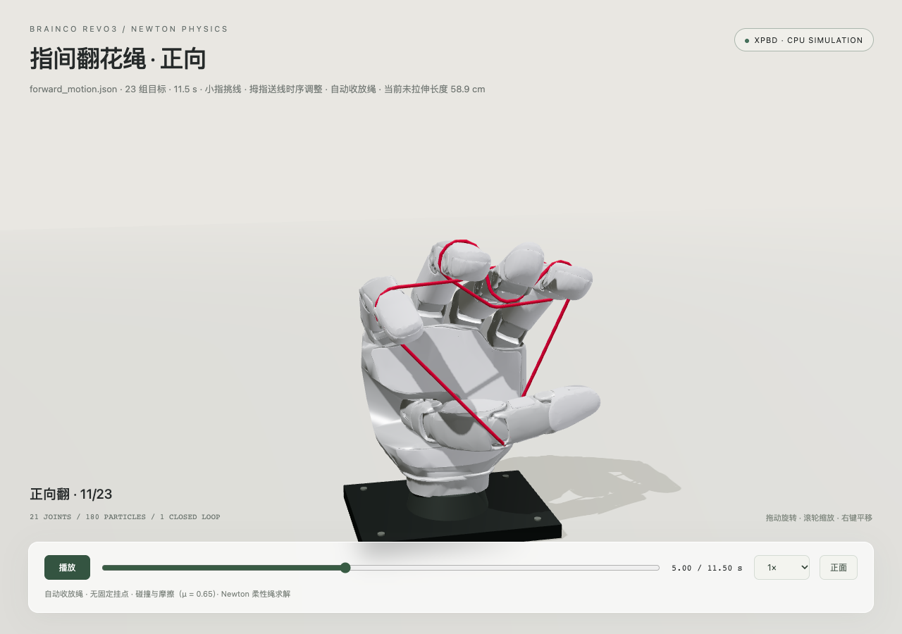
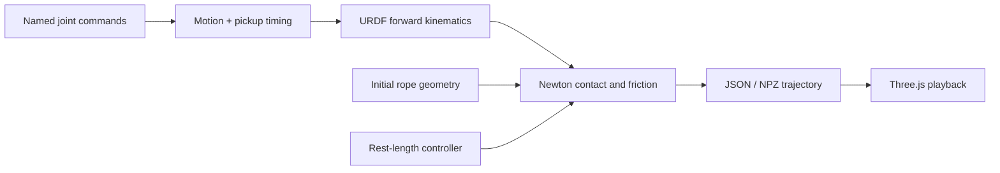

# Revo3 + Newton Cat's Cradle

A small, reproducible **single-hand string manipulation demo** using a BrainCo Revo3 hand and Newton XPBD. A recorded 21-joint command sequence drives a kinematic hand; a dynamic closed rope interacts with it through collision and friction.

The demo includes a hardcoded correction that lets the little finger pick up the **middle-to-thumb strand** around 4.5–5.2 s. It is a scripted simulation experiment, not a learned policy or a validated reproduction of a complete cat's-cradle routine.



## Run

Requirements: Git, [uv](https://docs.astral.sh/uv/), and network access for initial setup. Tested on Apple Silicon macOS, Python 3.12, CPU; CUDA is optional and untested here.

```bash
git clone https://github.com/DavidLXu/Revo3-Newton-CatCradle.git
cd Revo3-Newton-CatCradle
bash scripts/setup.sh
.venv/bin/python -m revo3_cat_cradle
bash scripts/serve.sh
```

Open **http://127.0.0.1:8765/web/**. The viewer starts paused and supports orbit, zoom, scrubbing and slow playback. To inspect the pickup, open **http://127.0.0.1:8765/web/?t=4.13**. Use `bash scripts/serve.sh 8766` if port 8765 is occupied.

Setup downloads pinned Newton and official Revo3 assets into ignored directories. The model download is several hundred MB. A default 11.5 s simulation takes a few minutes on the tested CPU (longer under load or on the first kernel compilation). The browser replays exported states; it does not run the physics solver.

## What is simulated

- **Hand:** exact URDF forward kinematics, 21 commanded joints, fitted capsule/box collision proxies. Rope forces do not move the hand.
- **Rope:** a closed chain of 180 dynamic particles, stretch springs and weak second-neighbor bend springs, solved by Newton XPBD. No hand attachments, zero-mass rope points, adhesion or runtime position projection.
- **Initial placement:** a manually seated, tensioned loop near the DIP metal bands. One-time collision clearance is part of initialization.
- **Motion:** 23 normalized command targets over 11.5 s, with quintic interpolation. During 4.0–5.5 s the little finger tucks and extends; the thumb delivers the strand earlier. Other fingers retain the supplied targets.
- **Length control:** enabled by default. Distributed spring rest lengths adapt to rope strain, with an extra 1 cm take-up bias. This is an ideal active-length approximation, **not a passive fixed-length rope or a physical spool**.

```bash
# Disable the local little-finger / thumb correction
.venv/bin/python -m revo3_cat_cradle --original-joints

# Passive material length; this may slip or fail to pick up the strand
.venv/bin/python -m revo3_cat_cradle --fixed-length --rope-length 0.4417950869

# Short diagnostic run without regenerating visual meshes
.venv/bin/python -m revo3_cat_cradle --duration 1 --no-meshes --output output/debug

# Other controls
.venv/bin/python -m revo3_cat_cradle --help
```

The rope model is not FEM or a torsion-aware rod. Capsule contacts are approximate, and there is no segment-level continuous collision detection. Numerical stability and a successful local pickup do not establish material accuracy, knot-topology preservation, or real-hardware transfer.

## Inverse motion

The inverse command file has 24 targets over 12 seconds. It starts at the forward final pose and ends at the forward initial pose. Inverse simulation inherits the actual forward-end rope positions, velocities, rest lengths and masses; it never reverses recorded rope frames or attaches particles to fingers.

```bash
# Export the forward reference used by the inverse validator
.venv/bin/python -m revo3_cat_cradle --motion-speed 1.5 \
  --output output/speed_1_5 --no-meshes

# Compute or reuse the forward physical seed, then undo the star at 1.5×
.venv/bin/python -m revo3_cat_cradle --direction inverse --motion-speed 1.5 \
  --seed-state output/speed_1_5/forward_checkpoint.npz --hold-after 2 \
  --output output/inverse_speed_1_5 --no-meshes

# Validate against the forward reference exported above
.venv/bin/python scripts/validate_inverse.py
.venv/bin/python scripts/render_stacked.py --simulation-dir output/inverse_speed_1_5
```

The checked 1.5× inverse takes 8 seconds plus 2 seconds of continued physics at the final pose. It removes the four palm-view crossings and maintains contact with all five fingers throughout the terminal hold. The final loop's symmetric mean distance to the settled initial reference is about 2.1 mm (maximum 3.8 mm). These are checks for this fixture, not a general knot invariant. Two command frames contain thumb PIP/DIP targets beyond the URDF range; the four explicit limit adjustments are recorded in `data/inverse_motion.json` and the motion audit. See [design notes](docs/design.md).

To inspect an exported inverse trajectory in the standard viewer, use `/web/?trajectory=../output/inverse_speed_1_5/trajectory.json` on the local server.

## Reproduce the latest portrait loop

After setup, run the following from the repository root. Install `ffmpeg` (including `ffprobe`) and either Google Chrome or Playwright Chromium (`.venv/bin/python -m playwright install chromium`).

```bash
# Settle the initial rope, then integrate forward and inverse continuously at 1.5×
.venv/bin/python scripts/run_cycle.py

# Export detailed meshes and check the studio scene
.venv/bin/python scripts/render_cinematic.py --simulation-dir output/cycle_speed_1_5 --preview

# Record synchronized fixed views with the latest English-only layout
.venv/bin/python scripts/render_stacked.py --simulation-dir output/cycle_speed_1_5 \
  --output-dir output/cycle_speed_1_5/portrait_english --loop

# Remove the last 2 seconds and hold the successful star for 1 extra second
.venv/bin/python scripts/edit_cycle_timing.py \
  output/cycle_speed_1_5/portrait_english/revo3_cycle_portrait.mp4 \
  output/cycle_speed_1_5/portrait_english/revo3_cycle_final.mp4

bash scripts/serve.sh
```

Open **http://127.0.0.1:8765/web/loop.html** for automatic repeat playback. The final MP4 is `output/cycle_speed_1_5/portrait_english/revo3_cycle_final.mp4`: 1080×1920, 30 fps, 546 frames, 18.2 seconds. The upper camera faces the palm; the lower camera is at −45°. The only visible labels are **Revo3**, **Cat's Cradle** (54 px), and **Newton physics**. The poster shows the completed star, without adding a cover segment to the movie.

The initial settling is excluded from the recording. In the reference run it took 3 seconds; the runner requires a full second of submillimeter shape convergence before starting. It exports settling, contact, crossing and endpoint checks in `cycle_validation.json`. Rope particles remain dynamic throughout the physical forward/inverse sequence.

The final one-second star hold is an editorial freeze frame. The last 0.6 seconds dissolve into the first settled image to smooth the playback seam; this does not alter the exported physics or imply an exactly periodic physical state. `edit_cycle_timing.py` deliberately accepts only the 576-frame, 30 fps cycle recording produced by this recipe.

## Code map



| File | Responsibility |
| --- | --- |
| `data/forward_motion.json` | Named URDF angles in radians; no device serial number or calibration file |
| `data/inverse_motion.json` | Reverse command sequence and explicit thumb-limit adjustments |
| `revo3_cat_cradle/motion.py` | Command loading, interpolation, little-finger angles and thumb timing |
| `revo3_cat_cradle/hand.py` | Official URDF parsing, forward kinematics and visual export |
| `revo3_cat_cradle/rope.py` | Initial closed-loop route and surface arcs |
| `revo3_cat_cradle/contact_geometry.py` | Shared finger capsules and one-time clearance |
| `revo3_cat_cradle/sim.py` | Parameters, collision bodies and simulation stepping |
| `revo3_cat_cradle/tension.py` | Optional strain-based active length control |
| `revo3_cat_cradle/rope_solver.py` | Newton adapter excluding adjacent rope particles from self-contact |
| `revo3_cat_cradle/__main__.py` | CLI, export and deformation checks |
| `web/` | Offline Three.js trajectory viewer |
| `scripts/run_cycle.py` | Initial settling and continuous forward/inverse physics with endpoint diagnostics |
| `scripts/render_cinematic.py`, `web/cinematic.js` | Detailed meshes, studio lighting and the orbiting landscape render |
| `scripts/render_stacked.py`, `web/stacked.html` | Synchronized portrait cameras and English-only titles |
| `scripts/edit_cycle_timing.py`, `web/loop.html` | Final star hold, shorter ending and repeat playback |

See [design and data notes](docs/design.md) for units, normalization assumptions and the pickup schedule.

## Validate and export

```bash
# Physics and motion tests; no precomputed trajectory needed
.venv/bin/python -m pytest -m 'not integration' -q

# Generate default output, then test full replay and target-strand pickup
.venv/bin/python -m revo3_cat_cradle
.venv/bin/python -m pytest -q

# Optional browser checks and screenshots
.venv/bin/python -m playwright install chromium
.venv/bin/python scripts/render_preview.py

# Optional MP4 export (also requires ffmpeg)
.venv/bin/python scripts/render_preview.py --video

# Studio lighting, detailed meshes and a 30-degree front orbit (−15° to +15°) (1080p / 30 fps)
.venv/bin/python scripts/render_cinematic.py --preview
.venv/bin/python scripts/render_cinematic.py

# Recompute physics with 1.5× joint motion, then record in real simulation time
.venv/bin/python -m revo3_cat_cradle --motion-speed 1.5 --output output/speed_1_5 --no-meshes
.venv/bin/python scripts/render_cinematic.py --simulation-dir output/speed_1_5 --playback-speed 1

# Synchronized fixed front and 45-degree oblique views, stacked for portrait
.venv/bin/python scripts/render_stacked.py --preview
.venv/bin/python scripts/render_stacked.py
```

The cinematic renderer uses the existing trajectory at 0.75× speed, with one-second opening and closing holds. It interpolates exported poses for display, without changing physics. It writes the MP4, four review images and render metadata to `output/cinematic_30deg/`. The interactive viewer keeps its original appearance.

`--motion-speed` changes the joint command timing during Newton integration, including the pickup corrections. Gravity, friction, solver timestep and active take-up rate remain in physical seconds. At 1.5×, the full motion takes 7.67 seconds; `--playback-speed 1` records that new trajectory at real time. This differs from speeding up an existing video. Correction timestamps in motion metadata remain in the original command timeline.

The portrait renderer writes `output/speed_1_5/portrait/` at 1080×1920 and 30 fps. Both fixed cameras show the same simulation timestamp. Its opening 0.8-second cover shows the final pose, followed by the complete trajectory with one-second opening and closing holds. It reuses the detailed meshes exported by the cinematic renderer.

The default run writes `output/trajectory.json`, `trajectory.npz`, `metrics.json`, `motion_audit.json` and `meshes.json`. Generated output is not committed. `--no-meshes` needs an existing `output/meshes.json` for viewing. Export tests intentionally require the full default run; they do not silently skip missing output. Rendering can use local Chrome via `--chrome /path/to/chrome`.

The CPU reference run has 346 states, no anchors, and a peak edge stretch ratio of about 1.175 (acceptance limit: 1.2). The pickup regression checks continuous contact with the **specified material strand** during 4.6–5.2 s and more than 2.5 cm median lift of the same particles. Loop winding alone is not a pickup test.

## 中文说明

这是一个精简的 Revo3 单手翻花绳仿真：手按关节指令运动，Newton 求解柔性闭环绳，手绳之间只通过碰撞和摩擦交互。小指先收拢到线下，拇指提前送线，再展开小指挑起中指到拇指的斜线。

默认启用主动收放绳，因此并非被动定长绳。动作是硬编码演示，未声称完整复现真实翻花绳。公开样例已转成具名 URDF 关节角；原始设备标识、零偏文件、参考视频和调参中间结果不在仓库中。安装、运行与测试命令见上文。

反向使用独立的反向关节记录，直接继承正向结束时的绳子位置、速度和张力，继续求解碰撞与摩擦。1.5 倍速反向动作历时 8 秒，随后保持末姿态继续仿真 2 秒；已检查掌前交叉解除、五指持续接触，以及恢复后的绳路与初始参考接近。

最新版竖屏循环视频的复现命令见 “Reproduce the latest portrait loop”：先让绳子静置稳定，再连续计算正翻和反翻，录制上下两个固定视角。最终成片为 18.2 秒，使用英文标题，星形画面额外定格 1 秒，片尾剪掉 2 秒并用 0.6 秒叠化衔接开头。定格与叠化属于视频剪辑，不修改物理轨迹。

## License and upstream code

Project code and normalized motion example: **Apache-2.0**. The rope-contact adapter retains Newton's copyright notice. Vendored Three.js r170 is **MIT**; its license is in `web/THREE-LICENSE.txt`.

Official BrainCo model files are fetched separately and are **not relicensed or distributed by this repository**. No standalone asset license was found in the pinned upstream tree; consult upstream terms before redistributing those assets. The preview is a simulation render using that model. See [THIRD_PARTY.md](THIRD_PARTY.md) for pinned revisions and attribution.
