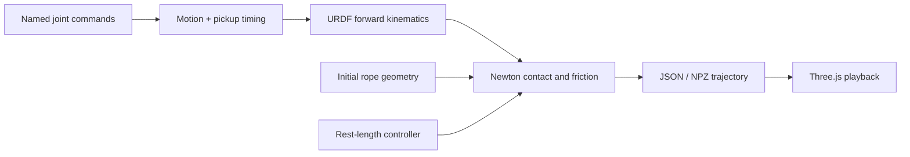

# Revo3 + Newton Cat's Cradle

A small, reproducible **single-hand string manipulation demo** using a BrainCo Revo3 hand and Newton XPBD. A recorded 21-joint command sequence drives a kinematic hand; a dynamic closed rope interacts with it through collision and friction.

The demo includes a hardcoded correction that lets the little finger pick up the **middle-to-thumb strand** around 4.5–5.2 s. It is a scripted simulation experiment, not a learned policy or a validated reproduction of a complete cat's-cradle routine.


## Run

Requirements: Git, [uv](https://docs.astral.sh/uv/), and network access for initial setup. Tested on Apple Silicon macOS, Python 3.12, CPU; CUDA is optional and untested here.

```bash
git clone https://github.com/DavidLXu/Revo3-Newton-CatCradle.git
cd Revo3-Newton-CatCradle
bash scripts/setup.sh
.venv/bin/python -m revo3_cat_cradle
bash scripts/serve.sh
```

Open **http://127.0.0.1:8765/web/**. The viewer starts paused and supports orbit, zoom, scrubbing and slow playback. To inspect the pickup, open **http://127.0.0.1:8765/web/?t=4.13**. Use `bash scripts/serve.sh 8766` if port 8765 is occupied.

Setup downloads pinned Newton and official Revo3 assets into ignored directories. The model download is several hundred MB. A default 11.5 s simulation takes a few minutes on the tested CPU (longer under load or on the first kernel compilation). The browser replays exported states; it does not run the physics solver.

## What is simulated

- **Hand:** exact URDF forward kinematics, 21 commanded joints, fitted capsule/box collision proxies. Rope forces do not move the hand.
- **Rope:** a closed chain of 180 dynamic particles, stretch springs and weak second-neighbor bend springs, solved by Newton XPBD. No hand attachments, zero-mass rope points, adhesion or runtime position projection.
- **Initial placement:** a manually seated, tensioned loop near the DIP metal bands. One-time collision clearance is part of initialization.
- **Motion:** 23 normalized command targets over 11.5 s, with quintic interpolation. During 4.0–5.5 s the little finger tucks and extends; the thumb delivers the strand earlier. Other fingers retain the supplied targets.
- **Length control:** enabled by default. Distributed spring rest lengths adapt to rope strain, with an extra 1 cm take-up bias. This is an ideal active-length approximation, **not a passive fixed-length rope or a physical spool**.

```bash
# Disable the local little-finger / thumb correction
.venv/bin/python -m revo3_cat_cradle --original-joints

# Passive material length; this may slip or fail to pick up the strand
.venv/bin/python -m revo3_cat_cradle --fixed-length --rope-length 0.4417950869

# Short diagnostic run without regenerating visual meshes
.venv/bin/python -m revo3_cat_cradle --duration 1 --no-meshes --output output/debug

# Other controls
.venv/bin/python -m revo3_cat_cradle --help
```

The rope model is not FEM or a torsion-aware rod. Capsule contacts are approximate, and there is no segment-level continuous collision detection. Numerical stability and a successful local pickup do not establish material accuracy, knot-topology preservation, or real-hardware transfer.

## Code map



| File | Responsibility |
| --- | --- |
| `data/forward_motion.json` | Named URDF angles in radians; no device serial number or calibration file |
| `revo3_cat_cradle/motion.py` | Command loading, interpolation, little-finger angles and thumb timing |
| `revo3_cat_cradle/hand.py` | Official URDF parsing, forward kinematics and visual export |
| `revo3_cat_cradle/rope.py` | Initial closed-loop route and surface arcs |
| `revo3_cat_cradle/contact_geometry.py` | Shared finger capsules and one-time clearance |
| `revo3_cat_cradle/sim.py` | Parameters, collision bodies and simulation stepping |
| `revo3_cat_cradle/tension.py` | Optional strain-based active length control |
| `revo3_cat_cradle/rope_solver.py` | Newton adapter excluding adjacent rope particles from self-contact |
| `revo3_cat_cradle/__main__.py` | CLI, export and deformation checks |
| `web/` | Offline Three.js trajectory viewer |

See [design and data notes](docs/design.md) for units, normalization assumptions and the pickup schedule.

## Validate and export

```bash
# Physics and motion tests; no precomputed trajectory needed
.venv/bin/python -m pytest -m 'not integration' -q

# Generate default output, then test full replay and target-strand pickup
.venv/bin/python -m revo3_cat_cradle
.venv/bin/python -m pytest -q

# Optional browser checks and screenshots
.venv/bin/python -m playwright install chromium
.venv/bin/python scripts/render_preview.py

# Optional MP4 export (also requires ffmpeg)
.venv/bin/python scripts/render_preview.py --video
```

The default run writes `output/trajectory.json`, `trajectory.npz`, `metrics.json`, `motion_audit.json` and `meshes.json`. Generated output is not committed. `--no-meshes` needs an existing `output/meshes.json` for viewing. Export tests intentionally require the full default run; they do not silently skip missing output. Rendering can use local Chrome via `--chrome /path/to/chrome`.

The CPU reference run has 346 states, no anchors, and a peak edge stretch ratio of about 1.175 (acceptance limit: 1.2). The pickup regression checks continuous contact with the **specified material strand** during 4.6–5.2 s and more than 2.5 cm median lift of the same particles. Loop winding alone is not a pickup test.

## 中文说明

这是一个精简的 Revo3 单手翻花绳仿真：手按关节指令运动，Newton 求解柔性闭环绳，手绳之间只通过碰撞和摩擦交互。小指先收拢到线下，拇指提前送线，再展开小指挑起中指到拇指的斜线。

默认启用主动收放绳，因此并非被动定长绳。动作是硬编码演示，未声称完整复现真实翻花绳。公开样例已转成具名 URDF 关节角；原始设备标识、零偏文件、参考视频和调参中间结果不在仓库中。安装、运行与测试命令见上文。

## License and upstream code

Project code and normalized motion example: **Apache-2.0**. The rope-contact adapter retains Newton's copyright notice. Vendored Three.js r170 is **MIT**; its license is in `web/THREE-LICENSE.txt`.

Official BrainCo model files are fetched separately and are **not relicensed or distributed by this repository**. No standalone asset license was found in the pinned upstream tree; consult upstream terms before redistributing those assets. The preview is a simulation render using that model. See [THIRD_PARTY.md](THIRD_PARTY.md) for pinned revisions and attribution.
