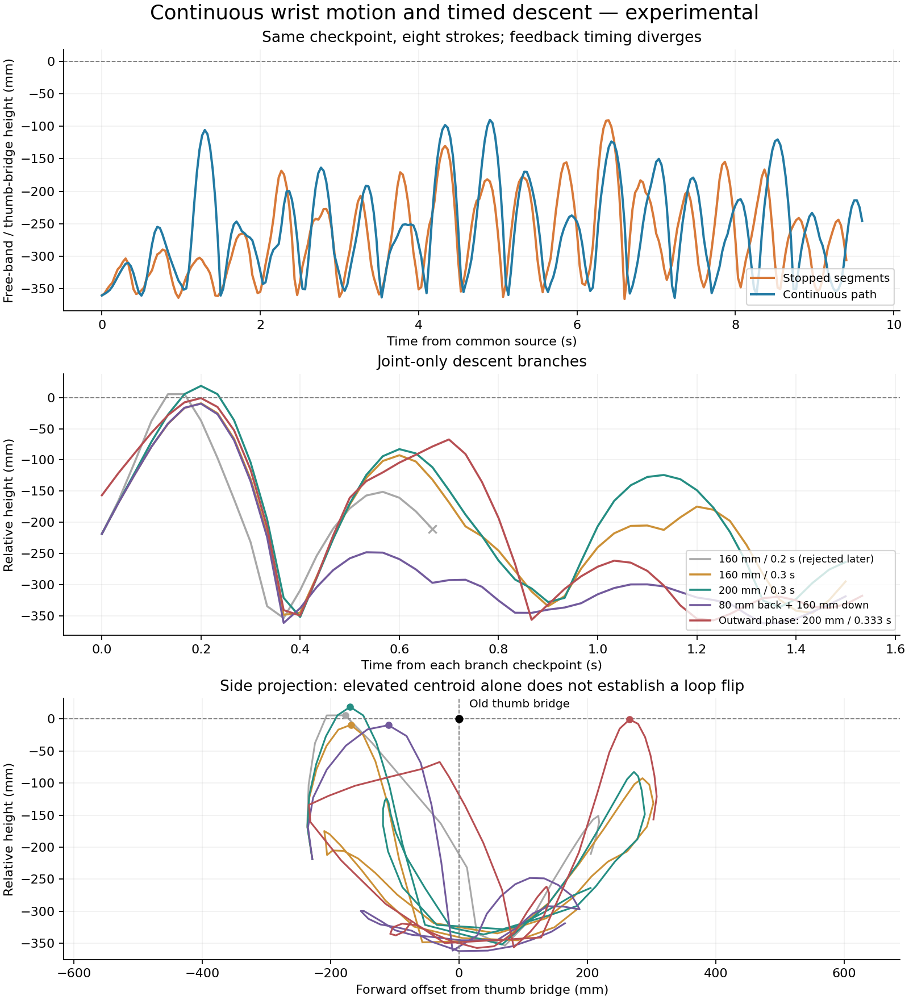

# Continuous wrist motion and timed descent

These experiments continue the [little-finger clearance trials](little-clearance.md).
They add a continuous wrist path and compare unused-finger withdrawal, swing
interpolation and timed hand descent. The loop flip and the full Cup & Saucer
→ boat → Star sequence remain unfinished.

## Withdrawing unused fingers

The source is the revised little-finger preparation at 44.266667 s. Its right
middle finger is already folded. Moving its MPR from −0.34 to −0.3491 rad and
MCP from 1.4 to 1.583 rad takes 0.8 s, followed by a 1.2 s hold. Four original
support tracks, bilateral release, held near-strand proximity, strict
nonpositive-gap holds and dynamic old-loop exclusion pass.

This does **not** fully clear the middle finger. The final second still has
26 of 31 frames with nonpositive middle/rope gaps; the minimum is −2.266 µm.
The right ring stays clear in that hold, with a minimum gap of 0.021 mm, and
the right little stays at least 16.181 mm away. These are sampled capsule-edge
and particle/mesh gaps, not measurements of a captured noose.

A second preparation folds the right ring too: MPR −0.338125, MCP 1.2, PIP
1.2 and DIP 0.7 rad, over 2 s. A frozen-rope planner predicts 6.573 mm ring
clearance. The dynamic rope follows the moving finger and ends in contact
with the middle, ring and little throughout the held second. The right
little-release check fails, so this endpoint is not used for a free-loop
swing. Its original supports and near-strand checks still pass.

Both proposals check their actual joint routes against same-hand, opposing
hand and palm proxies. Right middle/ring/little distal capsules also retain
positive own-palm bounds throughout the recorded preparation. A frozen-rope
clearance score is only a proposal; the Newton continuation decides whether
the rope follows the finger.

## One time envelope through the IK knots

The original wrist planner approximates Cartesian travel with several joint
segments. Every segment has zero endpoint velocity, producing repeated stops
inside one swing. `--continuous-wrist-path` instead fits a C2 cubic joint
spline through the same spatial IK knots and applies one quintic time envelope
to the entire stroke. Velocity and acceleration vanish only at its two ends.

The planner checks polynomial extrema against joint limits, bounds peak joint
speed conservatively at 3 rad/s, and samples relative wrist position and
orientation along the curved path. The existing 1 mm / 0.2° relative-wrist
limits stay unchanged. Continuation preflight samples the spline itself;
collision and grip checks still run during Newton integration. This controls
only robot joints.

`joint_paths` in motion metadata preserves the spline and its original time
scale. Resuming inside a path clips its history without replacing the executed
prefix with a new endpoint interpolation. Tests cover intermediate overshoot,
continuity at IK knots, repeated interior branching, serialization, and
identical particle states after a Newton checkpoint restart.

## Matched swings

Both swing trials start from the exact same 46.266667 s checkpoint of the
middle-only preparation. They use 0/+120 mm wrist targets, 0.5 s strokes,
five spatial IK intervals, a 10 mm directed center-crossing cue, eight strokes
and a final 1.2 s hold. The optional continuous interpolation is the only
input change. Feedback timing can subsequently differ because the rope states
diverge.

| Interpolation | End time | Highest band / bridge height | Held diagnostics |
| --- | ---: | ---: | --- |
| Stopped segments | 55.666667 s | −90.832 mm at 52.666667 s | Default and strict near holds pass; left little-release check fails. |
| Continuous spline | 55.866667 s | −89.976 mm at 51.166667 s | Default near hold passes; strict left hold and both little-release checks fail. |

Both retain four original support tracks and exclude old-loop pairing at every
recorded output frame. Their other physical release checks pass. Continuous
motion raises the band earlier, but its overall maximum is only 0.856 mm above
the stopped comparison. This pair does not establish a successful flip or a
robust height improvement. Neither final state qualifies as a verified
bilaterally released swing source.

## Descent while the loop rises

Four branches resume the exact 47.433333 s state of the continuous swing,
including particle velocities. The free band is rising on the body side of
the hands. Three lower both wrists vertically; the fourth also moves them
80 mm toward the body. All use continuous paths and hold finger targets fixed.

| Wrist motion | Highest band / bridge height | Outcome |
| --- | ---: | --- |
| Down 160 mm in 0.2 s | +5.548 mm at 47.6 s | Rejected at 48.133333 s: stretch 1.201322 exceeds 1.2. Last accepted frame is 48.1 s. |
| Down 160 mm in 0.3 s | −9.316 mm at 47.633333 s | Completes at 48.933333 s; both final little-release checks fail. |
| Down 200 mm in 0.3 s | +18.659 mm at 47.633333 s | Completes at 48.933333 s; left final little-release check fails. |
| Back 80 mm and down 160 mm in 0.3 s | −9.886 mm at 47.633333 s | Completes at 48.933333 s; both final little-release checks fail. |

All four retain the original support tracks and near-strand proximity through
their recorded intervals. The three completed descents pass held near proximity
and old-loop exclusion. Their strict held tests fail on both sides for the
slower 160 mm descent, and on the right for the other two. Remaining physical
release checks pass. They are not validated free-loop restart endpoints.

The positive heights are brief excursions on the body side. When the band
centroid subsequently crosses the projected X=0 plane of the thumb bridge,
it is below that bridge. This distinguishes a large swing from an observed
over-the-top passage; the projected centroid test alone cannot certify rope
topology.

The [Dressing a Pelt reference](https://www.alysion.org/figures/introkids1.htm)
requires an outward toss that passes over the held strings and returns toward
the body. A band centroid above the old thumb bridge does not establish that
passage. A further branch therefore starts at 51.066667 s, while the free band
is rising on the outward side, and lowers both wrists 200 mm in 0.333333 s.

The 0.3 s outward-phase proposal exceeds the 3 rad/s speed bound and is not
simulated. Increasing its duration to 0.333333 s brings the bound to 2.989
rad/s. That continuation completes at 52.6 s, retaining four original support
tracks, near proximity and old-loop exclusion. Its highest band centroid is
still 0.945 mm below the bridge at 51.266667 s. Both final little-release and
strict held-contact checks fail; the remaining physical release checks pass.
It also does not flip the loop.



The rope remains passive after 6 s: 1.363453388 m rest length, 689 dynamic
particles, radius 1 mm, friction 1.2, 96 substeps and 32 solver iterations.
No attachments, particle resets, length changes or extra rope forces are used.
The stretch rejection gate stays at 1.2 and physical arm/body hull contacts
remain enabled. Opening A is still an independent initial placement.

## Reproduce

First reproduce and audit `output/little_clear` using the linked clearance
notes. Then run the middle-only preparation and its source audits:

```bash
.venv/bin/python scripts/continue_cup.py --source output/little_clear \
  --output output/middle_clear --route-only --side both \
  --approach-path examples/transfers/attempt_withdraw_unused_middle.json \
  --check-self-collision --check-robot-hulls --check-body-envelope \
  --checkpoint-every-frame --max-stretch-ratio 1.2 --hold-duration 1.2 \
  --stop-on-support-loss --stop-on-grip-loss
.venv/bin/python scripts/audit_retained_supports.py --source output/middle_clear --start 6
.venv/bin/python scripts/audit_loop_release.py --source output/middle_clear \
  --start 44.266667 --released both
.venv/bin/python scripts/audit_near_pinch.py --source output/middle_clear \
  --side both --sampling edges
.venv/bin/python scripts/audit_dynamic_grip.py --source output/middle_clear --start 44.266667

.venv/bin/python scripts/control_loop_swing.py --source output/middle_clear \
  --output output/continuous_swing --amplitude .06 --center-offset .06 \
  --timing bottom --strokes 8 --stroke-duration .5 --cartesian-steps 5 \
  --probe-step .1 --apex-timeout 2 --apex-min-offset .01 \
  --hold-duration 1.2 --require-near-pinch --continuous-wrist-path
.venv/bin/python scripts/audit_retained_supports.py --source output/continuous_swing --start 6
```

Omit `--continuous-wrist-path` and use a separate output directory for the
stopped-segment comparison. To replay the 200 mm return-side descent, use its
exact interior checkpoint rather than the final swing state:

```bash
.venv/bin/python scripts/continue_cup.py --source output/continuous_swing \
  --checkpoint output/continuous_swing/state_1423.npz --output output/down200 \
  --route-only --side both \
  --approach-path examples/transfers/attempt_continuous_down200.json \
  --check-self-collision --check-robot-hulls --check-body-envelope \
  --checkpoint-every-frame --max-stretch-ratio 1.2 --hold-duration 1.2 \
  --stop-on-support-loss --stop-on-grip-loss
```

For the outward-side trial, use `state_1532.npz` with
`attempt_continuous_outward_descent.json` and a separate output directory.
The fast 160 mm descent is deliberately retained as a rejected experiment.
Do not use its failed terminal state as a valid continuation source.

The [numerical record](continuous_swing_20261109.json) contains checkpoint and
recipe hashes, preflight checks, audit results and accepted-prefix motion
measurements. Validation: 151 nonintegration tests pass; two integration tests
are excluded. Ruff F checks and `git diff --check` pass.
