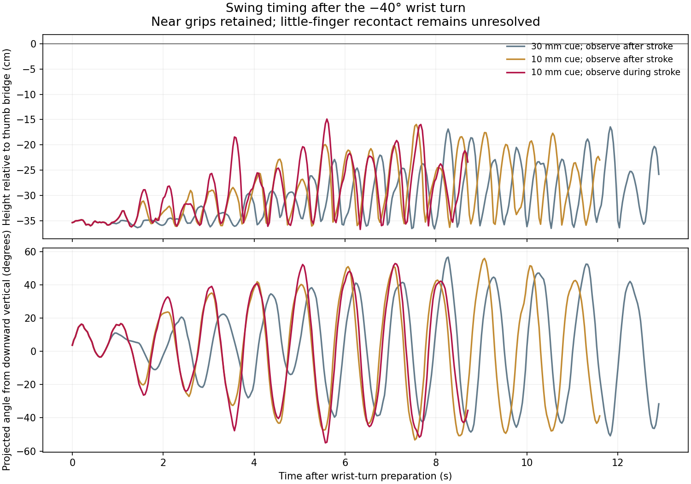

# Keeping the old loop out of the near-strand grip

The 39.066667 s [released clamp](pre-release-clamp.md) holds both near strands,
but a subsequent swing pulls the right old thumb loop into the same grip.
These trials change the fingers or wrist orientation before another swing.
None has completed a loop flip or Cup & Saucer.

At the source, right near edge 597 contacts the thumb PIP and index MCP. The
old thumb strand lies beside the thumb DIP and the same index MCP; its closest
paired-gap candidate has 0.572 mm index clearance. Moving the thumb tip away
can separate these strands, but also disturbs the intended grip.

| Joint motion | Measured result |
| --- | --- |
| Extend right thumb DIP from 0.2 to −0.15 rad over 0.8 s, then hold 1.2 s | Old-strand index clearance grows to 1.136 mm. Right near proximity is lost at 39.866667 s. Four original supports and physical release checks pass. |
| Compensate with a normal-directed right closure, then repeat with a −0.15 mm planning target | Proximity holds pass at 43.066667 and 44.866667 s; strict nonpositive-gap holds fail on the right. Old clearance shrinks to 0.737 and 0.425 mm. The planning target is not a measured rope penetration. |
| Slide the index surface while preserving the thumb DIP pose; frozen-geometry target 1 mm | Newton loses right near proximity at 40.166667 s. At 41.866667 s, old clearance is 0.754 mm and the near strand has a 0.489 mm thumb gap. Four original supports and release checks still pass. |
| Turn both wrists −40° about world Y over 1.6 s, then hold 1.2 s | Ends at 41.866667 s with four original supports, physical release checks, bilateral proximity and old-loop exclusion passing. Old clearance is 0.675 mm. The right strict hold fails, although the final frame has nonpositive gaps. |
| Turn +20° and advance 20 mm over 1.2 s, then hold 1.2 s | Ends at 41.466667 s with the same physical and proximity checks passing. Old clearance falls to 0.305 mm; the right strict hold fails. |

Clearance values above compare both capsule surfaces at the same sampled
material point, taking the candidate with the smallest maximum gap. They do
not establish force closure. Edge sampling uses 21 fractions per edge, and the
proximity threshold is 0.1 mm. Both whole old loops are checked for unwanted
paired samples, beyond the original thumb-contact windows.

These joint-motion branches retain the 1.363453388 m material rest length, 689 dynamic
particles, 1 mm radius and friction 1.2. Robot joints are the only commanded
state. A proposed 2 mm index slide fails its geometric checks and is never
integrated. Joint limits, arm/body contact, finger clearance and the 1.2 stretch
gate remain active.

A separate friction comparison changes the coefficient from 1.2 to 2.4 at the
original 39.066667 s checkpoint, then commands a stationary hold. It stops at
39.1 s: left near edge 307 reaches stretch 1.47271. This abrupt change at a
moving checkpoint does not test a rope initialized and settled with higher
friction.

## Stop at the first rejected frame

`continue_cup.py --stop-on-grip-loss` checks bilateral near proximity and old-loop
exclusion at the source and every 30 Hz output frame. It writes `grip_stop.json`
and the failed checkpoint at the first violation. The report identifies the
previous accepted frame; the failed state is retained for diagnosis. This is
an output-frame guard, so it does not locate the exact contact event between
solver substeps.

`control_loop_swing.py --require-near-pinch` now enables this guard inside each
stroke and observation probe. Older swing records in the preparation notes
were checked after a whole stroke and can contain a rejected tail.

Replaying the 1 mm slide with the guard stops at 40.166667 s, matching the offline
audit. The last accepted frame is 40.133333 s. Joint and rope arrays through
the failed frame are identical to the original unmonitored run. The shared
diagnostic also preserves the older swing's first old-loop failure at 41.666667 s.
Tests cover an extra old-loop grip while the near grip remains, and one-sided
loss of contact.

## Observe the approach during a stroke

The earlier controller begins feeding its phase detector only at the final
wrist waypoint. In the 10 mm cue trial, the second stroke approaches the
center at 43.133333 s with X = 26.2 mm. At the waypoint, X is already 9.3 mm,
inside the arming threshold. The detector misses the subsequent crossing at
43.2 s and waits for the next one at 44.166667 s.

The detector now observes the approach throughout the stroke. It accepts cues
only after the motion ends; crossings during motion are consumed rather than
replayed later. Regression tests recover the 43.2 s crossing from recorded
samples and reject a stale crossing inside a stroke. Each new control report
records this observation policy in `phase_observation`.

Three 100 mm swing trials complete eight strokes and a 1.2 s hold:

| Phase observations | Arming distance | Total continuation | Highest free band relative to thumb bridge |
| --- | --- | --- | --- |
| After each stroke | 30 mm | 12.9 s | −164.525 mm |
| After each stroke | 10 mm | 11.6 s | −159.738 mm |
| Throughout each stroke | 10 mm | 8.7 s | −149.052 mm |

All four original material tracks, bilateral near proximity, old-loop exclusion,
stretch, rope self-contact and arm/body clearance checks pass. Both little-finger
clearance checks fail in the final hold of all three trials. The recorded free
strands brush the little MCP capsules: examples include left edges 239–240 and
right edges 670–671. The continuing near grips alone do not validate a free-loop
throw. None of these runs reaches thumb-bridge height.



The current code passes 146 nonintegration tests, with two integration tests
excluded. The replay below uses the corrected phase observation:

```bash
.venv/bin/python scripts/control_loop_swing.py --source output/roll_back40 \
  --output output/phase_aware_swing --amplitude .05 --center-offset .05 \
  --timing bottom --strokes 8 --stroke-duration .5 --cartesian-steps 5 \
  --probe-step .1 --apex-timeout 2 --apex-min-offset .01 \
  --hold-duration 1.2 --require-near-pinch
```

Generate the source's material-support, release and near-pinch audits before
starting that controller, as described in the preparation notes.

## Replay

First reconstruct the 39.066667 s source using the table in
[the preparation notes](pre-release-clamp.md). For the wrist comparison:

```bash
.venv/bin/python scripts/continue_cup.py --source output/released_clamp \
  --output output/roll_back40 --route-only --side both \
  --approach-path examples/transfers/attempt_roll_released_back40.json \
  --check-self-collision --check-robot-hulls --check-body-envelope \
  --checkpoint-every-frame --max-stretch-ratio 1.2 --hold-duration 1.2 \
  --stop-on-support-loss --stop-on-grip-loss
```

The thumb-tip comparison starts from the same source with
`attempt_extend_right_thumb_tip.json`; its two closures follow with
`attempt_reclamp_after_tip_clear.json` and `attempt_reclamp_tip_second.json`.
The latter branches intentionally recover a lost grip, so omit
`--stop-on-grip-loss` during those closures. Source times, checkpoint hashes,
recipe hashes and individual audit results are in
[the recorded evidence](grip_clearance_20261108.json).
