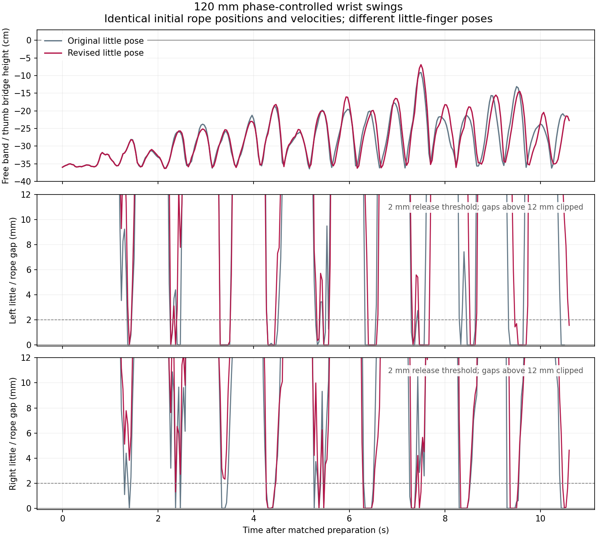

# Clearing the little fingers during the loop swing

The revised little-finger pose lifts the fixed free band to 69.006 mm below
the original thumb bridge in eight 120 mm strokes, compared with 91.143 mm
for a matched baseline. Both retain the near grips and four original supports,
but touch the little fingers again. Neither the loop flip nor Cup & Saucer
is complete.

This continues the [grip-clearance experiments](grip-clearance.md). The source
is the −40° wrist-turn preparation at 41.866667 s. An earlier twelve-stroke
120 mm reference reaches −85.369 mm. Compared with the earlier 100 mm trial,
both travel and stroke count increase, so that height difference cannot be
attributed to travel alone. The twelve-stroke trial ends at 54.566667 s;
the first nonpositive little-finger gaps occur at 43.2 s on the left and
45.166667 s on the right. Grazing contact does not prove a recaptured noose.

## Rejecting an overfolded finger

A geometry search compares candidate little-finger poses with the recorded
rope sweep, transformed into each wrist frame. Its first proposal predicts
2.285 mm left and 2.438 mm right rope clearance. That prediction overlooks
the left little DIP capsule intersecting its own palm hull.

The executed preparation retains the rope and passes the earlier release
checks, but the additional own-palm measurement finds a sampled overlap of
4.155 mm. It is withdrawn. The subsequent swing is stopped and is not used
as a restart state. The overlap concerns collision proxies; it does not
establish intersection of the original visual meshes.

`continue_cup.py --check-self-collision` now checks both little PIP/DIP capsules
against their own convex palm at the same sampled preflight poses as the
existing hand checks. The adjoining MCP is excluded. Replaying
`rejected_overfold_little.json` now fails before integrating its first motion
frame. The original counterexample is also covered by a regression test.

`audit_loop_release.py` reports the minimum own-palm bound over its requested
interval and the first little-rope proximity/contact times. Its existing
little-release criterion still requires more than 2 mm clearance during the
final one-second hold. The swing controller requires the new own-palm check
at its source; rerun release audits generated by earlier versions. These are
sampled proxy checks, not full robot self-collision or swept-contact checks.

## Revised preparation

The revised search reserves at least 1 mm of planned own-palm clearance.
Only five little-finger joints change over 1.2 s, followed by a 1.2 s hold:

| Joint | Source angle (rad) | Target angle (rad) |
| --- | ---: | ---: |
| Left little MPR | −0.5 | −0.5236 |
| Left little MCP | 1.4 | 1.55 |
| Left little PIP | 1.5 | 1.55 |
| Right little MPR | −0.5 | 0.1 |
| Right little MCP | 1.4 | 1.58 |

At 44.266667 s, physical release, original-material retention, bilateral
near-strand proximity, strict nonpositive-gap holds and old-loop exclusion
all pass. The recorded minimum own-palm lower bound is 1.144 mm. Minimum
little-rope gaps during this preparation are 12.427 mm left and 13.777 mm
right. The old frozen sweep predicts only 0.879 mm left clearance for this
safer pose; the next Newton run must measure the changed trajectory.

The rope keeps its 1.363453388 m rest length, 689 dynamic particles, 1 mm
radius and friction 1.2. No particles are attached to the hands or repositioned.
The full-history stretch gate remains 1.2; the measured history peak remains
1.199273. The starting Opening A is independently placed.

```bash
# First reproduce output/roll_back40 using grip-clearance.md.
.venv/bin/python scripts/continue_cup.py --source output/roll_back40 \
  --output output/little_clear --route-only --side both \
  --approach-path examples/transfers/attempt_clear_littles_own_palm.json \
  --check-self-collision --check-robot-hulls --check-body-envelope \
  --checkpoint-every-frame --max-stretch-ratio 1.2 --hold-duration 1.2 \
  --stop-on-support-loss --stop-on-grip-loss
.venv/bin/python scripts/audit_retained_supports.py --source output/little_clear --start 6
.venv/bin/python scripts/audit_loop_release.py --source output/little_clear \
  --start 41.866667 --released both
.venv/bin/python scripts/audit_near_pinch.py --source output/little_clear \
  --side both --sampling edges
.venv/bin/python scripts/audit_near_pinch.py --source output/little_clear \
  --side both --sampling edges --max-gap 0
.venv/bin/python scripts/audit_dynamic_grip.py --source output/little_clear --start 41.866667
```

## Matched eight-stroke swings

The revised pose and an unchanged-finger baseline both start at 44.266667 s.
The baseline holds the earlier wrist-turn pose for the same 2.4 s preparation
interval. Their starting particle positions, velocities, rest lengths and
spring arrays are identical. Both controllers use 0/+120 mm wrist targets,
0.5 s strokes, five Cartesian segments, a 10 mm center-crossing cue and eight
strokes followed by a 1.2 s hold.

| Little-finger pose | End time | Highest band / bridge height | First nonpositive gap, left / right |
| --- | ---: | ---: | ---: |
| Original | 54.766667 s | −91.143 mm | 45.633333 / 45.666667 s |
| Revised | 54.866667 s | −69.006 mm | 45.666667 / 48.566667 s |

The revised pose delays right little-finger contact by 2.9 s and raises the
highest band sample by 22.137 mm. Left contact occurs almost as early as in
the baseline. Both runs retain near proximity and exclude old-loop pairing
at every output frame. The strict held test fails on the left in both runs,
and both final little-release clearance checks fail; the remaining release
diagnostics pass. Neither endpoint is a verified free-loop swing source.



A separate capsule scan of 44.266667–54 s also records contact on the right
middle and ring fingers, beginning on free-arc edges 639 and 660. The next
clearance proposal needs to account for these surfaces too. Those contacts
are observations, not proof of an extra retained noose or the cause of the
remaining swing-height limit.

```bash
.venv/bin/python scripts/control_loop_swing.py --source output/little_clear \
  --output output/little_swing --amplitude .06 --center-offset .06 \
  --timing bottom --strokes 8 --stroke-duration .5 --cartesian-steps 5 \
  --probe-step .1 --apex-timeout 2 --apex-min-offset .01 \
  --hold-duration 1.2 --require-near-pinch
.venv/bin/python scripts/audit_retained_supports.py --source output/little_swing --start 6
.venv/bin/python scripts/audit_loop_release.py --source output/little_swing \
  --start 44.266667 --released both
.venv/bin/python scripts/audit_dynamic_grip.py --source output/little_swing --start 44.266667
```

## A vertical wrist flick

Two branches resume the exact 50.133333 s checkpoint of the revised swing,
including particle velocities. The free band is moving upward in front of
the hands. Both branches raise the wrists 80 mm over 0.2 s, then lower them
200 mm along the same Cartesian path. The final wrists are 120 mm below the
checkpoint pose; finger targets remain unchanged.

| Descent duration | Result |
| --- | --- |
| 0.233333 s; peak planned joint speed 2.751 rad/s | Right near proximity is lost at 50.5 s. The guard stops there; 50.466667 s is the last accepted sample. All four original supports remain tracked. |
| 0.466667 s; peak planned joint speed 1.375 rad/s | Completes the motion and a 1.2 s hold at 52 s. Both near grips, old-loop exclusion and four original support tracks pass. The right strict hold and left little-release clearance fail. |

Neither branch raises the free band above the thumb bridge. The highest
sample in the accepted fast prefix and in the slow branch is −188.830 mm,
at 50.166667 s. The slower descent preserves proximity but does not achieve
the required flip. Its other deformation, body and finger-clearance checks
pass; the failed little-release check excludes its endpoint as a verified
free-loop swing source.

After reproducing and auditing the revised eight-stroke swing as
`output/little_swing`, the slower branch can be replayed with:

```bash
.venv/bin/python scripts/continue_cup.py --source output/little_swing \
  --checkpoint output/little_swing/state_1504.npz --output output/slow_flick \
  --route-only --side both \
  --approach-path examples/transfers/attempt_phase_timed_wrist_flick_slow.json \
  --check-self-collision --check-robot-hulls --check-body-envelope \
  --checkpoint-every-frame --max-stretch-ratio 1.2 --hold-duration 1.2 \
  --stop-on-support-loss --stop-on-grip-loss
```

Checkpoint and recipe hashes, audit results, matched-state equality and the
withdrawn trial are in [the numerical record](little_clearance_20261109.json).
Validation: 147 nonintegration tests pass; two integration tests are excluded.
Ruff's undefined/unused-name checks and `git diff --check` pass.
