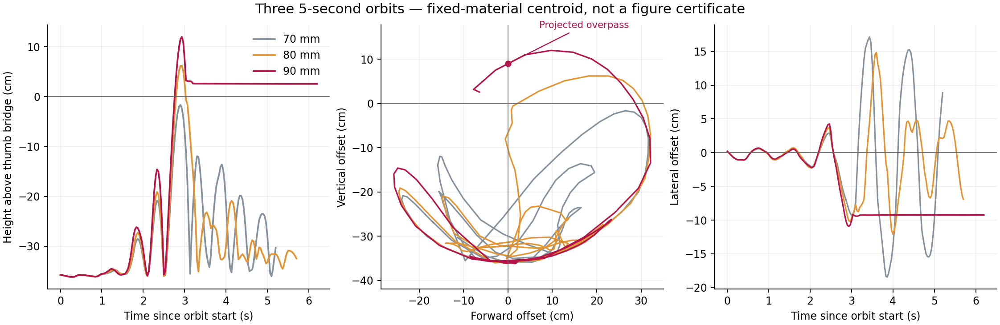

# A free-band overpass and the remaining hand contacts

A 90 mm wrist orbit carries the middle of the free loop above the original
thumb bridge and back toward the body. The final 1.2 s hold preserves the four
original supports, both near-strand proximity checks and bilateral little
release. It is a useful continuation state, but it is not a completed loop flip
or Cup: the free arc also contacts the right thumb base and middle finger.
A subsequent smaller closure followed by middle-finger extension clears the
middle contact and preserves the held proximity checks. The right far-index
leg still has not reached the thumb bridge.

These experiments continue the [cleared-palm preparation](palm-clearance.md).
The [numerical record](orbit_tuning_20261109.json) includes source/checkpoint
hashes, commands, measured contacts and rejected endpoints. Cup & Saucer,
boat and Star remain unfinished.

## Comparing the orbits

All five orbit trials start from the same actual 51.866667 s checkpoint.
Both wrists translate together in world X/Z with fixed orientations. Three
cycles share one quintic phase envelope; a 5 s command reaches 1.125 Hz at
its midpoint. The rope remains fully dynamic throughout.

| Radius X/Z | Duration | Highest band centroid above thumb bridge | Result |
| --- | ---: | ---: | --- |
| 80/80 mm | 5 s | +61.986 mm | No projected overpass; right near proximity lost at 57.6 s during the hold. |
| 70/100 mm | 5 s | +53.057 mm | No overpass; completes the hold. |
| 70/70 mm | 5.5 s | −83.011 mm | No overpass; final left little-release check fails. |
| 90/90 mm | 5 s | +119.801 mm | Projected overpass; completes the hold. |
| 80/80 mm, then 60 mm common descent | 5 s | +78.886 mm | No overpass; completes the hold. |

The descent ramps between normalized orbit phases 0.60 and 0.76. It is part
of the same C2 joint path, with no mid-motion stop or rope-state replacement.
It raises the peak relative height but does not complete the crossing.
All completed orbit holds pass default near proximity; their strict
nonpositive-gap near-contact checks fail. The 80 mm failure's last accepted
frame is 57.566667 s; its failed endpoint is excluded from accepted metrics.



The plot includes the earlier 70 mm, 5 s baseline. Increasing radius from
70 to 80 to 90 mm increases attained height in this comparison. The lateral
motion shows why the projected crossing still needs a contact check.

## What crossed, and where it landed

For the 90 mm orbit, the fixed band is material 102–118. Its centroid crosses
from positive to negative X relative to the original thumb bridge at an
interpolated 54.852623 s, 89.765 mm above the bridge. The complete band is
above it in both bracketing frames: its minimum relative height is 106.1 mm
at 54.833333 s and 64.1 mm at 54.866667 s. All 17 points move from positive
to negative relative X across that bracket.

The band is also about 104 mm to the right of the bridge centroid. At the
58.066667 s held endpoint, the free arc contacts the right thumb MCP around
edge 116 and right middle DIP around edge 144. The band stays 25.608 mm above
the bridge, rather than dropping back to its original hanging position.

A 21-sample-per-edge comparison finds the left far-index leg about 1.998 mm
from the original thumb bridge, at edges 217/472; the right far-index leg
remains at least 27.885 mm away in that sampling. The two legs therefore have
different final relationships to the bridge. These sampled distances and
finger contacts do not certify draping, force closure or rope topology.

The [Dressing a Pelt instructions](https://www.alysion.org/figures/introkids1.htm)
require the loose loop to pass over the held strings and hang over the near
thumb string before the thumbs move down and away through their old nooses.
The current evidence does not establish that full precondition. Continuing
directly to a successful-Cup label would skip the unresolved right-side transfer.

## Follow-up contact trials

A separate preparation applies a small right near-strand closure before any
orbit. It preserves the thumb DIP world pose through wrist compensation and
uses a −50 µm geometric surface target. Newton still determines rope motion.
It completes a 1.2 s hold at 53.666667 s; another 1.2 s hold ends at 54.866667 s.
Both retain the original supports, bilateral release and default near proximity,
but neither passes the right strict held-contact test. These are separate
preparations, not the source of the 90 mm orbit above.

Two trials branch from the completed 90 mm orbit at 58.066667 s:

* A −150 µm right closure target moves the planned index surface about
  266 µm over 0.3 s. It maintains near proximity, but at 59.233333 s the
  old-loop edge 408 also becomes paired between the right thumb/index.
  The wrong-strand guard stops it; last accepted time is 59.2 s.
* Extending only the right middle MCP/PIP/DIP toward zero over 1.6 s loses
  right near proximity at 59.2 s. Its last accepted frame is 59.166667 s.

Neither failed endpoint is a continuation source. Both retain the four
original support tracks through their failures, illustrating why those
tracks alone are not enough to accept a transfer.

The combined follow-up uses a −50 µm closure target (about 166 µm of planned
surface displacement) over 0.3 s, then extends the middle joints over 1.6 s.
It completes its 1.2 s hold at 61.166667 s. Original supports, bilateral little
release, dynamic near proximity, old-loop exclusion and default held near
proximity all pass. Both strict near-contact holds fail, so this is not an
improved force-closure claim.

During the final held second the original free arc stays at least 4.548 mm
clear of the right middle, measured with capsule edges and knuckle-mesh
particles. It still contacts the right thumb MCP. The sampled far-leg distances
to the thumb bridge are 1.999 mm on the left and 27.579 mm on the right.
This leaves a better cleared continuation state while preserving the unresolved
right-side routing in the record.

## Reproduce

First reproduce and audit the cleared-palm retraction at 51.866667 s from
[the preparation recipes](palm-clearance.md#reproduce-the-cleared-preparation).
The commands below call that output directory `output/cleared_retreat`.

```bash
.venv/bin/python scripts/plan_loop_orbit.py --source output/cleared_retreat \
  --output output/plans/orbit90.json --radius-x .09 --radius-z .09
.venv/bin/python scripts/continue_cup.py --source output/cleared_retreat \
  --output output/orbit90 --route-only --side both \
  --approach-path output/plans/orbit90.json \
  --check-self-collision --check-robot-hulls --check-body-envelope \
  --checkpoint-every-frame --max-stretch-ratio 1.2 --hold-duration 1.2 \
  --stop-on-support-loss --stop-on-grip-loss
.venv/bin/python scripts/audit_retained_supports.py --source output/orbit90 --start 6
.venv/bin/python scripts/audit_loop_release.py \
  --source output/orbit90 --start 51.866667 --released both
.venv/bin/python scripts/audit_near_pinch.py --source output/orbit90 --side both --sampling edges
.venv/bin/python scripts/audit_near_pinch.py \
  --source output/orbit90 --side both --sampling edges --max-gap 0
.venv/bin/python scripts/audit_dynamic_grip.py --source output/orbit90 --start 51.866667
.venv/bin/python scripts/inspect_loop_throw.py --source output/orbit90 --start 51.866667
```

The strict near-contact command is expected to fail for this recording. The
planner requires matching bilateral-release and held-near reports at its
source checkpoint. It writes a proposed joint path, not a physical result.
Joint limits and the unchanged 3 rad/s bound are checked analytically for
the serialized polynomial; wrist errors are sampled. Collision and physical
contact checks remain part of the Newton continuation and its audits.

Use a fresh output recipe path for each plan. Change `--radius-x`,
`--radius-z` and `--duration` for the other table rows; the descent uses
`--radius-x .08 --radius-z .08 --late-z -.06`. Each case uses the same
source, not the preceding run's endpoint. New proposals must pass their own
preflight and physics checks.

The short follow-up recipes are in `examples/transfers/`:

| Recipe | Source | Planned command |
| --- | --- | --- |
| `attempt_retracted_right_preload50.json` | Cleared retraction, 51.866667 s | 0.6 s closure, then 1.2 s hold |
| `rejected_after_orbit_preload150.json` | Completed 90 mm orbit, 58.066667 s | 0.3 s closure, then 1.2 s hold |
| `rejected_after_orbit_unfold.json` | Same completed orbit | 1.6 s middle extension, then 1.2 s hold |
| `attempt_after_orbit_combined.json` | Same completed orbit | 0.3 s smaller closure, 1.6 s middle extension, then 1.2 s hold |

Use the same continuation guards as above. To reproduce the extra stationary
preparation, run `continue_cup.py --hold-only --side both --hold-duration 1.2`
from the first recipe's result, retaining those guards.

Material rest length remains 1.363453388 m after 6 s, with 689 positive-mass
particles, no anchors, friction 1.2, 96 substeps and 32 iterations. No rope
positions, velocities or rest lengths are overwritten. The full-history
stretch gate stays at 1.2 and arm/body hull contacts remain active. Initial
Opening A is still an independent placement.

Validation: 155 nonintegration tests pass, two integration tests are excluded,
and Ruff F checks pass. The public planner exactly reproduces the executed
80 and 90 mm orbit polynomials. Its late-descent polynomial matches within
1e-8 coefficient tolerance, and an over-speed proposal is rejected without
writing a recipe.
