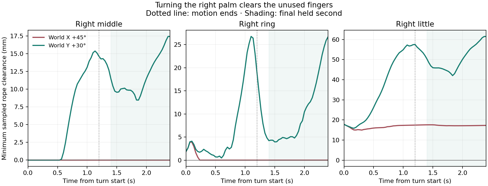
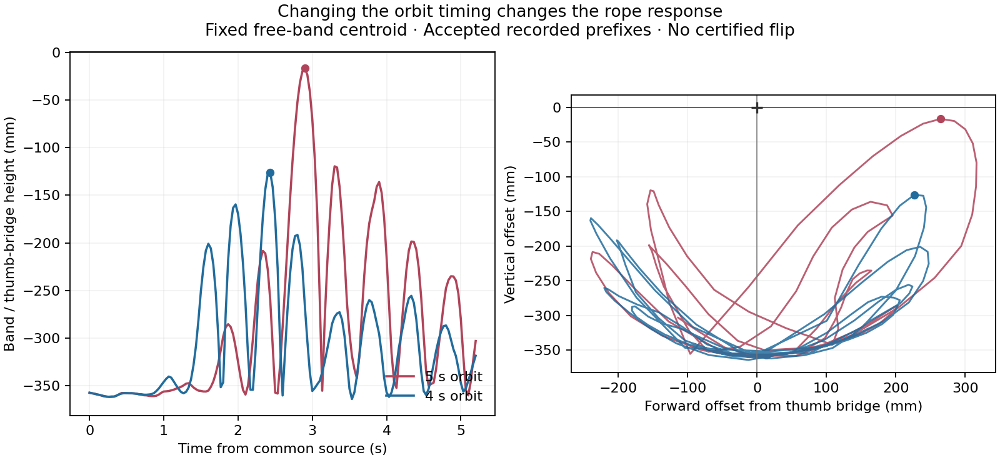

# Palm orientation and the free loop

A 30° right-hand turn clears the unused right fingers while preserving the
original thumb/index supports and both near-strand grips. This is a new
preparation for the free-loop flip. Cup & Saucer, boat and Star remain unfinished.
The trials continue the [continuous-wrist experiments](continuous-swing.md).

## Clearing the right middle finger

The common source is the middle-only preparation at 46.266667 s. Its folded
right middle finger still touches the free leg around the MCP. Straightening
the MCP, PIP and DIP over 1.6 s does not resolve this contact: both middle and
ring remain in contact throughout the final held second. The four original
supports, bilateral release and default near-strand checks pass, but the
right strict held-contact check fails.

The next planner rotates the right hand about a point sampled from its near
grip. The left hand stays fixed. This point guides wrist inverse kinematics;
it is never attached to the rope. The planner checks joint limits, speed,
same-hand and opposing-hand proxies, palm clearance and the original support
references. Newton then determines whether the rope follows the moving hand.

| Right-hand motion, followed by a 1.2 s hold | Actual final-second result |
| --- | --- |
| +45° about world X in 1.2 s | Middle and ring still touch in all 31 held frames. Original supports, release and default near proximity pass; strict near contact fails. |
| +30° about world Y in 1.2 s | Middle stays at least 8.458 mm clear, ring 3.942 mm and little 42.041 mm. Original supports, bilateral release, default and strict near contact, and dynamic old-loop exclusion all pass. |

The +45° proposal had the best frozen-rope clearance score, but its dynamic
rope follows the hand and remains on the unused fingers. The +30° proposal
does clear them. This comparison is why the planner's frozen geometry is not
used as a success test.



At the successful preparation's 48.666667 s endpoint, strict held-contact
samples persist on left near edge 307 and right near edge 596. These are
same-material samples with nonpositive gaps to both surfaces, not measured
grip forces. Right middle and little own-palm lower bounds stay positive
throughout the recorded turn. A final free-arc-only check also confirms that
the clearance is not an artifact of looking at the wrong rope segment.

## Short strokes and a translated start

Two shorter swing trials start from the original 46.266667 s source, before
the right-hand turn. They use continuous wrist paths, eight strokes, a 10 mm
center-crossing cue, observations every 1/30 s and a final 1.2 s hold.

| Common wrist travel | Stroke duration | Highest free-band centroid relative to the thumb bridge |
| --- | --- | ---: |
| 0–60 mm forward | 0.2 s | −133.286 mm |
| 0–80 mm forward | 0.266667 s | −111.217 mm |

Both preserve four support tracks and dynamic near proximity. Their final
left little-release checks fail. The 60 mm trial fails strict near contact on
both sides; the 80 mm trial fails it on the right. Neither flips the
free loop. Shorter strokes alone do not improve on the earlier 120 mm trial.

A separate 100 mm common retraction takes 2 s, followed by a 1.2 s hold. At
49.466667 s it passes original-support, bilateral-release, default and strict
near-contact checks. It reserves forward travel but does not clear the middle
finger. The follow-up 80 mm, 0.2 s swing uses twelve strokes and the new
projected-overpass cue. Its highest band is 82.515 mm below the bridge; it
still does not flip. Both final little-release checks and the left strict
near-contact check fail. Original supports and dynamic near proximity pass.

## Rotating the held strings

From that retracted source, rotating both hands 60° around the line between
their near-grip references preserves the original supports and near proximity,
but both little fingers contact the rope again. The final bilateral-release
and left strict near-contact checks fail. The loop still hangs below the hands.

A further plan combines a 90° rotation with a 100 mm retraction over 4 s.
An interpolating joint spline overshoots a joint limit even though its IK
samples are in range. A clamped cubic B-spline using those samples as control
points stays in their convex hull. Its serialized polynomial path passes the
existing C2 continuity, limit and speed checks; sampled relative-wrist errors
are 0.151 mm and 0.057° against the unchanged 1 mm / 0.2° limits.

That kinematic correction does not make the physical maneuver succeed.
Newton stops at 53.266667 s with stretch 1.223799, exceeding 1.2. The last
accepted frame is 53.233333 s. Support tracking and near-proximity checks
pass through the recorded failure, but the failed state is not a valid
continuation source. The recipe is explicitly named
`rejected_bounded_grip_roll90.json`.

## Moving from the cleared palm

The 80 mm swing from the 30° right-hand preparation completes at 53.6 s.
Its highest band remains 150.959 mm below the bridge. Original supports and
dynamic near proximity pass; final left little release and both strict near
holds fail. This is not a matched comparison with the earlier 80 mm trial:
the changed arm posture requires a slower 0.333333 s stroke.

The 120 mm, 0.633333 s comparison plans eight strokes but stops at 57.133333 s,
just after the seventh begins, when right near proximity is lost. Its last
accepted frame is 57.1 s. The accepted prefix reaches −109.430 mm at
56.333333 s; original support tracking passes, but the final hold is never
completed. This is another rejected endpoint, not a fallback swing source.

A free-arc-only audit of 48.666667–52.4 s locates renewed contacts on the
right ring at 49.633333 s, left little at 49.733333 s and right middle at
49.766667 s. The left middle, left ring and right little stay over 2 mm clear
in that prefix. Contact returning during the swing does not by itself prove
recapture of a noose or explain why the flip fails.

The next preparation retracts the cleared palms 100 mm in 2 s and holds
for 1.2 s, ending at 51.866667 s. Its bounded joint spline avoids a 0.000644 rad
overshoot of the right wrist limit in the interpolating proposal. All original
supports, bilateral release, dynamic near proximity and the default held
near test pass. The right strict same-material hold fails. Right middle,
ring and little minimum held gaps are 12.302, 1.550 and 49.500 mm, respectively.

This retracted preparation is the source for a scripted three-cycle circular
motion. Both wrists follow the same X/Z orbit, with fixed orientations, over
5 s. The orbit radius is 70 mm; a global quintic time envelope ramps its phase
up and down, reaching 1.125 Hz at the midpoint. The preflight speed bound is
2.131 rad/s, relative-wrist drift 0.125 mm and rotation error 0.026°.

[RopeFormer](https://ropeformer.github.io/) studies sustained bimanual rope
rotation in Newton and uses observed action–response history to adapt its
learned policy. Our orbit is a separate scripted proposal for the held closed
figure, driven by explicit robot joint commands.

The 5 s orbit's accepted prefix reaches a centroid height of −16.616 mm at
54.766667 s, on the outward side of the bridge. The complete 17-particle band
is still below it, from −19.267 to −12.952 mm, and no projected overpass is
observed. At 57.1 s, during the final hold, the right near-proximity check
fails. The last accepted frame is 57.066667 s. Four original supports remain
tracked, but this endpoint is rejected as a held continuation source.

A matched faster orbit uses the same source checkpoint and spatial polynomial
over 4 s. Only the duration changes; peak phase frequency becomes 1.40625 Hz
and the joint-speed bound is 2.664 rad/s.

The faster orbit completes its hold at 57.066667 s. Original supports,
dynamic near proximity and default held proximity pass; the left little-release
and right strict near-contact checks fail. Its peak is lower: −126.073 mm at
54.3 s. It also produces no projected overpass. Increasing speed in this
matched pair reduces the attained height rather than completing the flip.



## A directional observation cue

`control_loop_swing.py --stop-cue overpass` observes the fixed free-band
centroid relative to the original thumb bridge. It records a candidate only
when consecutive samples cross from positive world X to nonpositive X and
both are more than 20 mm above the bridge. The event time and position are
linearly interpolated between those samples.

This avoids stopping on a high excursion that stays on one side of the held
strings. It is still a projected centroid cue: it does not establish that
the complete loop crossed every held strand or formed Cup. The existing
`elevation` cue remains the default for old command lines. New controller
reports mark `final_hold_completed` only after the final physical hold returns.

## Reproduce the cleared preparation

First reproduce `output/middle_clear` using the
[previous preparation commands](continuous-swing.md#reproduce). Then:

```bash
.venv/bin/python scripts/continue_cup.py --source output/middle_clear \
  --output output/right_palm_clear --route-only --side both \
  --approach-path examples/transfers/attempt_right_palm_clearance.json \
  --check-self-collision --check-robot-hulls --check-body-envelope \
  --checkpoint-every-frame --max-stretch-ratio 1.2 --hold-duration 1.2 \
  --stop-on-support-loss --stop-on-grip-loss
.venv/bin/python scripts/audit_retained_supports.py \
  --source output/right_palm_clear --start 6
.venv/bin/python scripts/audit_loop_release.py \
  --source output/right_palm_clear --start 46.266667 --released both
.venv/bin/python scripts/audit_near_pinch.py \
  --source output/right_palm_clear --side both --sampling edges
.venv/bin/python scripts/audit_near_pinch.py \
  --source output/right_palm_clear --side both --sampling edges --max-gap 0
.venv/bin/python scripts/audit_dynamic_grip.py \
  --source output/right_palm_clear --start 46.266667

.venv/bin/python scripts/control_loop_swing.py --source output/right_palm_clear \
  --output output/cleared_swing80 --amplitude .04 --center-offset .04 \
  --timing bottom --strokes 8 --stroke-duration 0.3333333333333333 \
  --cartesian-steps 10 --probe-step 0.03333333333333333 \
  --apex-min-offset .01 --hold-duration 1.2 --require-near-pinch \
  --continuous-wrist-path --stop-cue overpass
```

The 120 mm comparison uses amplitude/center offset `.06`, stroke duration
`0.6333333333333333` and 19 Cartesian intervals. Faster proposals fail the
unchanged 3 rad/s speed check and are not integrated.

Other recipes use the same `continue_cup.py` options and a 1.2 s hold. Each
row starts from the named preparation, not from the preceding table row.

| Recipe in `examples/transfers/` | Source | Command duration |
| --- | --- | ---: |
| `attempt_unfold_unused_middle.json` | `middle_clear` at 46.266667 s | 1.6 s |
| `attempt_right_grip_roll45.json` | `middle_clear` at 46.266667 s | 1.2 s |
| `attempt_common_retreat100.json` | `middle_clear` at 46.266667 s | 2 s |
| `attempt_near_grip_axis_roll60.json` | Result of common retraction at 49.466667 s | 3 s |
| `rejected_bounded_grip_roll90.json` | Result of common retraction at 49.466667 s | Planned 4 s; rejected before completion |
| `attempt_cleared_palm_retreat100.json` | `right_palm_clear` at 48.666667 s | 2 s |
| `attempt_circular_loop_swing.json` | Result of cleared-palm retraction at 51.866667 s | 5 s |
| `attempt_circular_loop_swing_fast.json` | Same cleared-palm retraction | 4 s |

Run the support, release, near and dynamic audits after each completed
preparation, using its source time for `--start`. For the failed 90° roll,
inspect the rejected checkpoint and audit the accepted prefix; do not use it
as a released, held source. The circle replay uses the recorded joint
polynomial, so it does not require a separate planner or unpublished model.

The rope keeps its 1.363453388 m passive rest length after 6 s, 689 dynamic
particles, 1 mm radius, friction 1.2, 96 substeps and 32 solver iterations.
Robot joints are the only commanded state. No attachments, particle resets
or runtime length changes are added; the stretch gate stays at 1.2 and physical
arm/body hull contacts stay enabled. Opening A remains an independent initial
placement, and the sampled proxy checks are not a full swept self-collision
or rope-topology certificate.

The [numerical record](palm_clearance_20261109.json) preserves checkpoint and
command hashes, rejected plans and physical audit results for 14 Newton
continuations. All nine published recipes also pass endpoint, C2 spline,
joint-limit and 3 rad/s bound checks where applicable. Validation: 155
nonintegration tests pass, with two integration tests excluded. Ruff F checks
and `git diff --check` pass.
