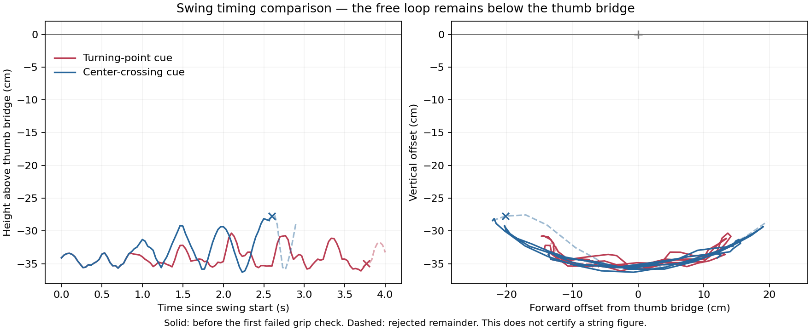

# Clamp before releasing the little loops

The newest release preparation retains both intended near-index strands through
an edge-contact hold with **nonpositive gaps to both surfaces**. It first tucks
the unused right middle, releases both little loops, and slightly closes the
right grip. All four original thumb/index material tracks and physical release
checks pass at 39.066667 s. This sampled geometric result does not measure
contact force or certify a completed loop flip.

The historical "pinch" results below use a 0.1 mm proximity threshold unless
stated otherwise. That tolerance can pass before opposed contact: the earlier
26 s preparation has no persistent edge passing a zero-gap test on either hand.
The complete Cup, boat and Star sequence remains unfinished. Full-history peak
stretch is **1.19927**, close to the unchanged 1.2 rejection threshold.

The [Dressing a Pelt instructions](https://www.alysion.org/figures/introkids1.htm)
press the near index strings before releasing the little loops. Earlier
experiments added the clamp after release. This branch restores the reference
order, starting from the collision-enabled 60° forward-tilted Opening A at
9.6 s. The initial Opening A remains an independent placement.

The rope uses the same 689 dynamic particles, 1 mm radius, friction 1.2 and
fixed 1.363453388 m rest length after 6 s. Only robot joints change during these
continuations. Finger, palm, arm/body and strain guards stay enabled.

## Recorded comparisons

| Trial | Recorded result |
| --- | --- |
| Left fingertip closure from 9.6 s, planned over 2.4 s | Contact stops closure at 11.033333 s. A 1.2 s hold ends at 12.233333 s. All six supports and physical checks pass; near edges 311–312 remain paired through the final second. Peak stretch 1.14073. This is a separate trial. |
| Right side closure from 9.6 s, planned over 0.633333 s | Stops at 10.133333 s with stretch 1.54332 on near edge 595. Old thumb material also enters the grip. Rejected. |
| Right fingertip closure from 9.6 s, planned over 2.4 s | Stops at 11.866667 s with stretch 1.20407 on edge 617. No paired target sample or edge has formed. Rejected. |
| The same right side-closure target, planned over 2.4 s | Contact stops closure at 11.533333 s. A 1.2 s hold ends at 12.733333 s. All six supports and physical checks pass; near edge 596 remains paired through the final second. Peak stretch 1.14247. |
| Add the left clamp to that right-hand hold | Both near strands contact opposing surfaces at 14.566667 s, with all six supports retained. The subsequent hold fails at 15.533333 s: right near edge 599 reaches stretch 1.24339. The final state is rejected. |
| Resume the exact 14.566667 s checkpoint and move each wrist inward 5 mm | Motion lasts 0.6 s, followed by a 1.2 s hold ending at 16.366667 s. All six supports and physical checks pass. The intended pinch gaps are slightly open; persistent bilateral pinch fails. Peak stretch 1.17059. |
| Close those gaps by index joints alone | Stops at 16.533333 s with stretch 1.21047 on edge 599. Rejected. The planned right contact point has 0.395 mm tangential motion as well as 0.376 mm normal motion. |
| Close along the surface normal while counter-moving the wrists | Both-hand contact stops closure at 16.6 s. The 1.2 s hold ends at 17.8 s. All six support tracks and physical checks pass. Left near edges 306–307 and right near edges 598–599 remain paired throughout the final second. Peak stretch 1.19927. |

The slow right trial stops before the planned endpoint. Slower motion changes
both dynamics and displacement between the 30 Hz contact checks; the result
does not establish that the full endpoint is safe.

The final closure coordinates thumb-base and index joints with wrist IK.
Thumb PIP/DIP angles remain unchanged. The sampled planned path preserves each
thumb's world pose within 0.000480 mm position error, with maximum commanded
joint speed 0.01379 rad/s. The index-carried surface reference approaches along
the nearest thumb normal. This reference is a planning target, not a rope
attachment. Newton still determines the material motion and contact.

The final wrist separation is 190.046 mm. No old-thumb or whole-old-loop point
samples are paired in the final contact observation. These sampled results do
not exclude all unsampled contact. The last twelve stretch measurements vary
from 1.18231 to 1.19062 and end at 1.18370; stationary joints do not imply that
the rope has settled.

## Turning and little-finger withdrawal

A further common 20° downward turn from the 17.8 s clamp keeps all finger
angles fixed. The 1 s motion and 1.2 s hold end at 20 s. All six original
material tracks, physical checks and bilateral pinch checks pass. Near edges
306–307 on the left and 598–599 on the right persist through the final second.
The final-frame stretch ratio falls to 1.14570; the earlier full-history peak
remains 1.19927. Neither old thumb strand has a paired point or edge sample in
the final observation. Both little fingers still contact their original loops.
This is the clean source for the two subsequent comparisons.

Abducting and folding the little fingers from that pose takes 1.8 s, followed
by a 1.2 s hold to 23 s. The original six tracks and intended pinches remain,
and physical checks pass, but both little loops remain caught. More critically,
the right old thumb strand enters the grip at 22.633333 s: point 408 and edges
407–408 have paired contact samples. The near strand is still held as well.
This is an unwanted additional grip, despite passing the near-pinch audit.

The folded branch then tries a further 40° common turn and 80 mm advance.
Unmodified wrist IK switches arm configurations mid-path; its sampled relative
wrist drift reaches 12.004 mm and peak joint speed 3.665 rad/s, so that proposal
is not executed. Guiding the shoulder joints toward a reachable endpoint while
solving the wrist pose at each waypoint reduces these values to 0.0821 mm and
0.797 rad/s. The accepted geometry keeps the fingers unchanged and does not
move or constrain the rope.

Newton nevertheless rejects this folded-finger branch at 24.5 s: right near
edge 599 reaches stretch 1.20038. The old right strand is still caught, and the
left intended strand no longer has paired edge samples. The failed state is
not a restart. Geometry planning and preservation of the four original
supports did not make this a successful release.

A separate branch resumes the clean 20 s checkpoint, leaving the little
fingers extended. It turns both wrists another 60°, advances them 100 mm and
lowers them 40 mm over 4.8 s, then holds for 1.2 s. Shoulder guidance limits
sampled relative wrist drift to 0.208 mm, orientation drift to 0.0709° and
peak joint speed to 0.833 rad/s. At 26 s all six original tracks, physical
checks and bilateral pinch checks pass. Left edges 306–307 and right edges
597–598 persist through the final second. Both little loops remain retained.

This downward-facing pose is the newest clean preparation. Final-frame stretch
is 1.03744, and the nearest right old-thumb sample has 0.980 mm clearance from
the index. Neither old loop has paired point or edge samples in the final
observation. The earlier 1.19927 history peak still applies. The recipe is
`attempt_clamped_unfolded_turn60.json`, starting from the clean 20 s state,
not from the rejected folded branch.

These comparisons use `attempt_clamped_turn20.json`,
`attempt_clamped_little_fold.json` and `rejected_clamped_folded_turn40.json`,
respectively. Keep the same continuation guards and 1.2 s hold duration as
below; no near-contact trigger is needed when the hands are already clamped.
Audit both near-strand contact and unwanted old-strand contact after replay.

## Release, secondary contacts and loss of the near grip

Folding the little fingers from the clean 26 s downward pose clears both little
loops by 27.366667 s, with about 50 mm capsule clearance and both intended
near strands still inside the proximity threshold. Continuing the full fold
and hold fails at 28.033333 s: edge 624 reaches stretch 1.23180. The released
far strand is caught between the right index and middle MCP capsules. The
original thumb strands are not in the pinch.

An exact continuation from `state_0821.npz` at 27.366667 s changes only the right
middle MPR from 0.4 to −0.2 rad over 0.4 s, then holds for 1.2 s. It ends at
28.966667 s. All four original material tracks and the physical bilateral
little-release audit pass. Minimum little clearances during the final second
are 59.604 mm left and 27.656 mm right. Final-frame stretch is 1.00908.

The near-strand audit nevertheless fails: left proximity is first absent at
28.3 s, and right proximity at 28.966667 s. The final left thumb gap is 0.624 mm.
The right middle finger also contacts another part of the free arc near
particle 678. This is a measured release with retained original loops, not a
ready-to-throw bilateral pinch.

A subsequent right-middle MCP fold to 1.4 rad ends at 31.366667 s after another
1.2 s hold. The four original tracks and bilateral release audit still pass.
Only right near edge 597 persists; the left near strand has moved farther away.
The right middle now contacts old-loop material near 386 instead of the free
arc. Normal-only reclamping proposals from this pose, including a wider joint
search and an index-PIP variant, fail their geometric target tolerances and
are not simulated.

A separate continuous-motion comparison starts from the exact 27.766667 s
checkpoint (`state_0833.npz`) after the first middle withdrawal, while both
intended strands still have paired samples. A 60 mm forward wrist translation
over 0.4 s, followed by one observation frame, ends at 28.2 s with both intended
strands still within the proximity threshold. A 60 mm return over the same
duration ends at 28.633333 s with the left proximity lost. These are dynamic
prefixes, not completed stationary pinch holds. The free band's highest measured
position remains 281.1 mm below the original thumb bridge. The loop has swung;
it has not gone over the bridge. The route helper's generic turning-point
caption does not imply that these two fixed-duration strokes used an apex trigger.

The additional recipes are `rejected_downward_clamped_fold.json`,
`attempt_release_middle_clear.json`, `attempt_release_middle_fold.json`,
`attempt_continuous_forward_stroke.json` and
`attempt_continuous_return_stroke.json`. Use the exact prefixes specified above;
the failed fold's final state is not a valid source. The continuous strokes
use a hold duration of `0.03333333333333333` s, not the 1.2 s preparation hold.

## Proximity and nonpositive surface gaps

The original stop test accepts up to 0.1 mm positive gap on each capsule
surface. It can therefore stop before opposed compressive contact. The segment
contact adapter applies its normal and friction corrections only when the
segment penetrates the combined collision radius. Proximity, sampled surface
contact and measured grip forces are distinct quantities. Other collision
geometry and contact at solver substeps are outside the capsule snapshot test.

`continue_cup.py --hold-on-near-pinch both --pinch-max-gap 0` now requires
nonpositive gaps to both surfaces at the same material sample before stopping
closure. The original default stays at 0.0001 m for historical reproduction.
The value can be tightened within `[0, 0.0001]`; it cannot weaken the existing
proximity gate. The trigger records the threshold used.

The matching audit is:

```bash
.venv/bin/python scripts/audit_near_pinch.py --source output/preloaded \
  --side both --sampling edges --max-gap 0
```

A tightened audit writes `near_pinch_strict_edge_audit.json` (or
`near_pinch_strict_audit.json` for point samples), preserving the original
proximity report. Nonpositive gaps are still a sampled geometric condition,
not a contact-force measurement or force-closure certificate.

The first tighter closure resumes the clean 26 s preparation and moves the
planned index surface references about 81 µm left and 66 µm right toward the
thumbs. It completes a 1.2 s hold at 28.4 s with six supports and the physical
checks retained, but does not trigger the zero-gap condition. Neither hand has
a persistent edge passing the zero-gap audit. This result motivates further
small joint closures; it is not a validated pressure grip.

The next closure uses the measured 28.4 s state and a −0.15 mm target gap for
the index-carried planning references. Its zero-gap event stops motion at
28.866667 s, followed by a hold to 30.066667 s. Six original supports and the
physical preparation checks pass. The zero-gap hold audit still fails on both
hands, while the historical proximity audit passes. The worst per-frame best
common-edge gaps are 0.206 µm left and 4.364 µm right; those best samples can
change material and are not a persistent-contact certificate.

The two closures use `attempt_zero_gap_closure.json` and
`attempt_zero_gap_second_closure.json`. Use `--hold-on-near-pinch both
--pinch-max-gap 0` alongside the existing collision, strain and original-support
guards. The second recipe is also suitable for a separately recorded comparison
that executes the entire target without the near-contact stop. Those are
different physical trajectories and must retain separate outputs.

Executing the full second target without stopping at contact fails at
29.466667 s: left near edge 309 reaches stretch 1.21608. All six original
material tracks remain, but the physical strain and completed-hold checks
fail. This rules out that full closure as a usable preparation; its failed
final state is not a restart.

Regression checks cover separated surfaces that pass the old proximity test
but fail zero-gap contact, compressed opposing surfaces, interior edge samples
and invalid thresholds. There are 141 passing non-integration tests; the two
integration tests are excluded from that result.

## Clear the unused middle before releasing the little loops

The next branch starts from the contact-triggered second closure at
30.066667 s. It moves only the right middle finger: MPR to −0.34 rad over
0.6 s, PIP/DIP to 1.5/0.8 rad over 1.2 s, then MCP to 1.4 rad over 1.2 s.
A simultaneous fold and a narrower lateral route intersect the frozen rope
and are not simulated. The accepted staged proposal stays within the joint
limits, with sampled finger/palm clearance and at most 0.1193 mm frozen-rope
penetration. These are planning checks, not a dynamic clearance certificate.

The resulting physical continuation holds for 1.2 s and ends at 34.266667 s.
All six original support tracks and physical preparation checks pass. Both
near strands pass the historical proximity hold: left edges 306–307 and
right edges 597–598. Left edge 307 also passes the nonpositive-gap hold;
the right hand does not. Final-frame stretch is 1.04060 and this continuation's
peak is 1.09737, below the inherited 1.19927 history peak. The recipe is
`attempt_pre_release_middle_tuck.json`; do not use a near-contact stop for
this movement of an inactive finger.

The prepared little-finger withdrawal then ends at 37.266667 s, including a
1.2 s hold. All four original thumb/index material tracks, bilateral little
release and physical checks pass. Both near strands also pass the proximity
hold: left edges 306–307 and right edges 597–598. Left edges 306–307 pass
nonpositive gaps; right contact still fails that stricter hold. Minimum little
clearances in the final second are 51.128 mm left and 44.991 mm right. No old
thumb or whole-old-loop points/edge samples have paired contact in the final
observation. This is a clean release preparation under these diagnostics,
not a completed loop flip. The recipe is `attempt_tucked_little_release.json`.

A right-only normal closure from the released 37.266667 s state preserves
both thumb world poses while changing right thumb-base/index joints and
counter-moving its wrist. The planned reference displacement is about 174 µm,
with maximum commanded joint speed 0.00673 rad/s. The 0.6 s motion and 1.2 s
hold end at 39.066667 s. No particle-only zero-gap trigger fires; the full
planned target executes. Interior edge samples then pass the stricter final
one-second hold on both hands: left edges 306–307 and right edge 597.

All four original tracks and physical bilateral-release checks pass, with no
old-strand paired point or edge samples in the final observation. Final-frame
stretch is 1.06831, and the closure branch peaks at 1.14353. This uses
`attempt_released_right_closure.json` with `--hold-on-near-pinch right
--pinch-max-gap 0`, while retaining `--side both` and all continuation guards.

The swing controller now accepts `--require-near-pinch`. It validates a current
bilateral held edge-proximity report before starting and checks both target
strands at every recorded frame after each stroke/probe, before issuing the
next command. It does not claim substep feedback, a persistent edge across the
whole swing, or force closure. A lost near grip or an old loop entering the grip rejects that stroke even
when the four original support tracks remain.

## First guarded swing and an unexecuted fast return

From the released 39.066667 s clamp, a 100 mm forward wrist movement over
0.6 s keeps both near strands inside the proximity gate at every recorded
frame. Subsequent probes detect a forward free-band apex at 40.066667 s. All
four original tracks and non-hold physical checks pass through that dynamic
prefix; no old strands have paired samples in its final observation. The free
band remains at least 319.1 mm below the thumb bridge, so this is not a flip.

The controller rejects its next planned 200 mm return before execution:
0.6 s would require 3.974 rad/s and produces 1.248 mm sampled relative wrist
drift, exceeding the existing 3 rad/s and 1 mm limits. The state at 40.066667 s
is an intact dynamic prefix, unlike a state rejected by a physical stretch or
contact failure. There is no completed stationary hold at that apex.

Reproduce this measured prefix and expected planning rejection with:

```bash
.venv/bin/python scripts/control_loop_swing.py --source output/released_clamp \
  --output output/guarded_swing --amplitude 0.1 --strokes 3 \
  --stroke-duration 0.6 --cartesian-steps 6 --probe-step 0.1 \
  --apex-timeout 2 --hold-duration 1.2 --require-near-pinch
```

Two continuations preserve that exact apex state. The full 200 mm return
uses 0.9 s and nine Cartesian segments: peak commanded joint speed is
2.732 rad/s, with 0.592 mm relative wrist drift. It ends at 41 s after one
observation frame. A shorter return only to the original wrist position uses
100 mm over 0.5 s and five segments; it ends at 40.6 s. Its corresponding
limits are 2.475 rad/s and 0.336 mm. Both keep the four original material
tracks and pass all non-hold physical checks. Neither is a stationary hold.

Both continuations also pass a per-frame near-proximity/old-grip audit from
39.066667 s. The closest the fixed free band gets to thumb-bridge height is
still 309.8 mm below it in the long return and 312.8 mm below it in the short
return. Neither produces a flip. The recipes are
`attempt_apex_return_retimed.json` and `attempt_apex_return_center.json`, both
starting at the intact 40.066667 s apex and using a single observation-frame
hold of `0.03333333333333333` s.

The additional motion audit is:

```bash
.venv/bin/python scripts/audit_dynamic_grip.py --source output/return_trial \
  --start 39.06666666666667
```

It checks both near strands and excludes paired old-loop samples in each
recorded frame, without claiming persistent material across the motion or a
stationary hold. As regression comparisons, it detects the known right old-loop
pairing at 22.633333 s in the shallow folded trial and the known left grip loss
at 28.333333 s in the earlier continuous return.

The swing controller also accepts `--center-offset` to avoid making every
return twice the first stroke's travel. With `--amplitude 0.05 --center-offset
0.05`, the two targets are 0 and +100 mm relative to the initial wrists. Both
targets must remain within 120 mm of that initial position. `--timing bottom`
uses a directed X=0 crossing of the fixed free band relative to the original
thumb bridge instead of an X turning point. This is a projected phase cue,
not a claim that the complete deformable loop is at its lowest point. The
crossing must be approached from the opposite side and have the correct
velocity sign; stale, noisy and wrong-direction observations cannot trigger it.

## Short-stroke phase comparison

Both phase trials start from the held 39.066667 s clamp, use targets at 0 and
+100 mm, and leave friction at 1.2. Each stroke takes 0.5 s in five Cartesian
segments. Eight strokes are requested, with 0.1 s observation probes, a 2 s
cue timeout and a planned final 1.2 s hold; neither trial reaches that hold.

The turning-point trial completes five strokes. The sixth loses right near
proximity at 42.833333 s, so the next command is rejected. The last valid grip
frame is 42.8 s (`state_1284.npz`). Before that failure, the fixed free band's
projected angular range is 50.164°, and its highest point remains 303.289 mm
below the thumb bridge.

The center-crossing trial detects cues at 39.8 and 41.3 s and commands reversals
at the probe endpoints, 39.866667 and 41.366667 s. It reaches a 70.929° projected
range and 281.160 mm below the bridge before a grip check fails. At 41.666667 s,
right old-loop edges 408–409 enter the paired-surface proximity zone during
the third stroke. The last clean grip frame is 41.633333 s (`state_1249.npz`).
The full output later reaches 275.607 mm below the bridge, but that value is
after the unwanted old-loop pairing and is not progress from a valid grip.

Both full outputs retain the four original material tracks and pass all
non-hold physical checks. That does not override their failed grip diagnostics.
The controllers check a completed stroke/probe before issuing another one:
their output ends at 43.066667 and 41.966667 s respectively, after the first
failed frame. Do not use those final states as a clean-grip continuation.



For the turning-point comparison:

```bash
.venv/bin/python scripts/control_loop_swing.py --source output/released_clamp \
  --output output/short_stroke_pump --amplitude 0.05 --center-offset 0.05 \
  --strokes 8 --stroke-duration 0.5 --cartesian-steps 5 --probe-step 0.1 \
  --apex-timeout 2 --hold-duration 1.2 --require-near-pinch
```

Use a separate output and add `--timing bottom` for the crossing comparison.
The next geometric question is how to keep the right old loop out of the grip
while retaining the intended near strand. Frozen proposals for 1.5 and 3 mm
old-loop clearance from the held clamp fail the near-reference/target
tolerances and are not executed. More friction alone would not address the
wrong-strand geometry found in the crossing trial.

## Check the current phase

`audit_loop_release.py --released none` requires both little contacts to remain
through the transfer, along with the existing strain, separation,
robot-clearance and completed-hold checks. It writes `pre_release_audit.json`.
After intended release, use the appropriate `left`, `right` or `both` mode.
The swing controller explicitly requires a current report with both little
loops released; passing a retention audit cannot authorize a free-loop swing.

`audit_retained_supports.py --include-little` follows the original little
material as well. Each little support is the endpoint of the opposite hand's
original far-index arc. Its report is `six_material_support_tracking.json`;
the four-support report used by continuation stays separate. Runtime
`--stop-on-support-loss` still guards the four thumb/index tracks; little
retention is audited after replay. Contact tracks are not a threading certificate.

The edge-pinch audit requires opposing surfaces at the same sampled fraction
of a near-strand edge. A persistent edge can have different contact fractions
over time. In the final right grip, the particle-only audit misses contact;
common interior-edge samples pass. Neither diagnostic establishes force closure.

## Reproduce

First reproduce the collision-enabled Opening A and the 9.6 s `forward_tilt`
preparation using the [collision correction and tilt commands](alternate-cup.md).
Then execute the following continuations, auditing the source before each one:

| Source | Recipe in `examples/transfers/` | Near-contact stop | Output |
| --- | --- | --- | --- |
| `output/forward_tilt` | `attempt_pre_release_right_clamp.json` | `right` | `output/early_right` |
| `output/early_right` | `attempt_pre_release_second_clamp.json` | `left` | `output/early_bilateral` |
| `output/early_bilateral`, exact `state_0437.npz` | `attempt_pre_release_span_relief.json` | none | `output/early_relief` |
| `output/early_relief` | `attempt_pre_release_normal_refine.json` | `both` | `output/early_normal` |

For example, the first continuation is:

```bash
.venv/bin/python scripts/audit_retained_supports.py --source output/forward_tilt --start 6
.venv/bin/python scripts/continue_cup.py --source output/forward_tilt \
  --output output/early_right --side both --route-only \
  --approach-path examples/transfers/attempt_pre_release_right_clamp.json \
  --hold-on-near-pinch right --hold-duration 1.2 --stop-on-support-loss \
  --check-self-collision --check-robot-hulls --check-body-envelope \
  --max-stretch-ratio 1.2 --checkpoint-every-frame
.venv/bin/python scripts/audit_retained_supports.py --source output/early_right --start 6
.venv/bin/python scripts/audit_retained_supports.py --source output/early_right --start 6 --include-little
.venv/bin/python scripts/audit_loop_release.py --source output/early_right --start 9.6 --released none
.venv/bin/python scripts/audit_near_pinch.py --source output/early_right --side right --sampling edges
```

Use the same guards and hold duration for the other rows. The second row is
expected to fail during its final hold. The third row must explicitly specify
`--checkpoint output/early_bilateral/state_0437.npz`, the valid bilateral-contact
frame, rather than using that failed final state. Preserve its rope positions,
velocities and spring rest lengths. Audit both hands after the final row.
A replay with different contact timing needs its own verified prefix; do not
assume the historical checkpoint number is valid for different parameters.

The newer clean release chain continues the final `output/early_normal` row:

| Source | Recipe in `examples/transfers/` | Contact stop | Recorded end | Output |
| --- | --- | --- | --- | --- |
| `output/early_normal` | `attempt_clamped_turn20.json` | none | 20 s | `output/down20` |
| `output/down20` | `attempt_clamped_unfolded_turn60.json` | none | 26 s | `output/down60` |
| `output/down60` | `attempt_zero_gap_closure.json` | both, max gap 0 | 28.4 s | `output/zero1` |
| `output/zero1` | `attempt_zero_gap_second_closure.json` | both, max gap 0 | 30.066667 s | `output/zero2` |
| `output/zero2` | `attempt_pre_release_middle_tuck.json` | none | 34.266667 s | `output/middle_tuck` |
| `output/middle_tuck` | `attempt_tucked_little_release.json` | none | 37.266667 s | `output/little_release` |
| `output/little_release` | `attempt_released_right_closure.json` | right, max gap 0 | 39.066667 s | `output/released_clamp` |

Each row uses a 1.2 s hold and the same runtime guards. Before little release,
run the six-support tracker and `audit_loop_release.py --released none`.
From little release onward, track the four thumb/index supports and audit
`--released both`. Use the row's source time as that release audit's `--start`.
Run both default and `--max-gap 0` edge audits on `output/released_clamp`; the
recorded result passes both. Event timing is measured, so a replay that stops
at another time needs its own checked source, not an assumed historical time.

The [machine-readable report](pre_release_clamp_20261108.json) records source
and result hashes, stops, support and pinch evidence for the recorded trials.
Recipes named `rejected_` are failure reproductions. A simultaneous-closing
proposal passed geometry planning but was not simulated. Subsequent release
and loop-throw work must keep these distinctions.
