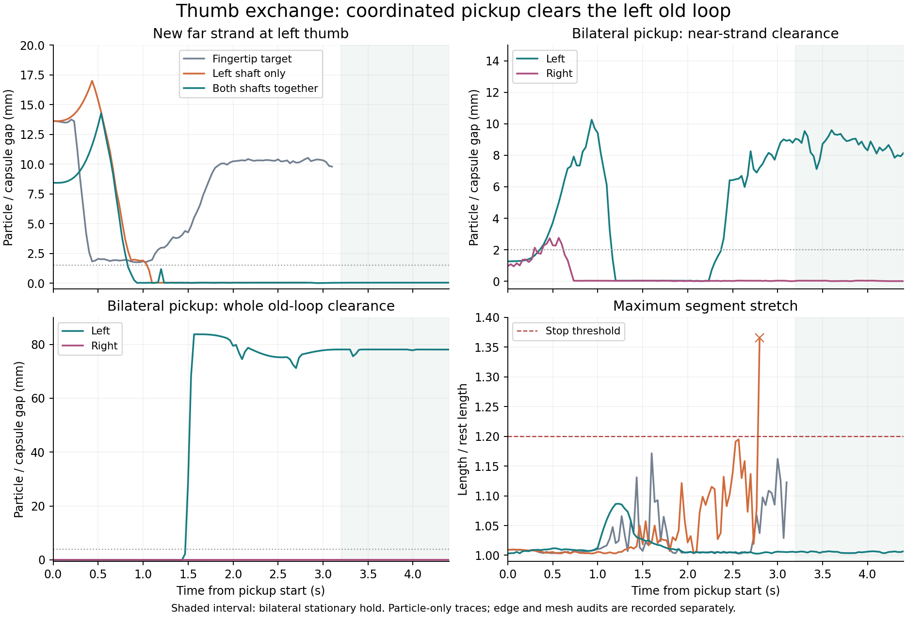
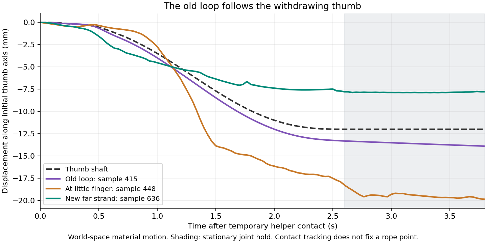
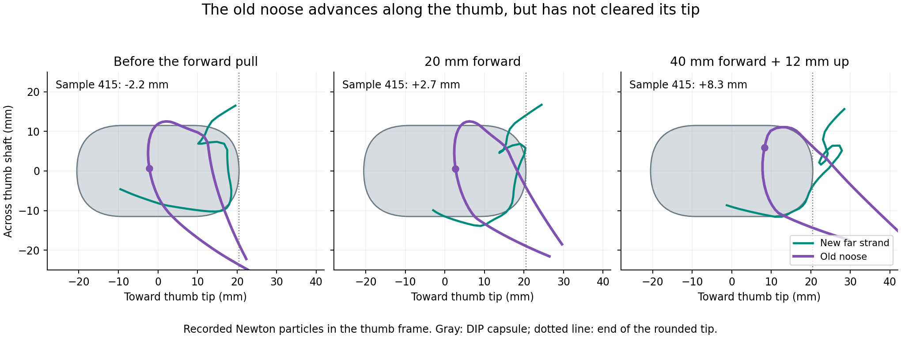

# Coordinated thumb pickup and the remaining right loop

Moving both hands together produces a useful transfer state at 67.366667 s.
Both new far strands remain at the thumbs throughout the final stationary
second. The left thumb clears its complete old loop and its near strand;
the right thumb still carries both unwanted strands. Cup & Saucer, boat and
Star are not complete.

This continues the [orbit and middle-clearance experiments](orbit-transfer.md).
The [numerical record](thumb_exchange_20261109.json) includes the failed
alternatives, source hashes, joint recipes and audit results. All reported
results come from Newton replays; proposed finger positions are not substituted
for rope motion.

## What changed in the motion

A fingertip target approached the far strand but left it ahead of the rounded
end. When that thumb rose, the strand stayed behind and the new contact was
lost. The next proposal put the distal shaft beneath the strand instead.
Achieving that position required wrist and index motion together: the planner
kept the index DIP pose approximately fixed while moving the palm and thumb.
That reference affects joint planning only; it does not attach the rope.

The left-only shaft motion caught the far strand but also met its neighboring
strand. It hit the unchanged 1.2 stretch limit at 65.766667 s, reaching 1.3660
at the rejected frame. The right-only shaft motion lost the other hand's
original thumb support at 64.666667 s. It also fails the full-history sampled
rope self-contact audit. Neither failed state is a continuation source.

The bilateral proposal uses the same 62.966667 s preparation for both hands,
combines their joint curves, and checks the combined hand clearance. Both
old thumb supports are explicitly allowed to leave during this phase; both
original index material tracks remain required. The 3.2 s motion completes
its 1.2 s hold without a runtime stop.

| Final held-second measurement | Left | Right |
| --- | ---: | ---: |
| Maximum far-strand edge/mesh gap | Contact, within 1 µm | 0.435 mm |
| Minimum near-strand gap | 7.125 mm | Contact |
| Minimum whole old-loop gap | 77.808 mm | Contact |
| Persistent far material samples | 209–226 | 636–637 |

The complete physical audit passes its stretch, sampled rope self-contact,
finger clearance, opposing-palm, arm/body hull, little-release and stationary
hold checks. Both original index tracks pass. The exchange audit still fails
right near/old-loop clearance and unused right-finger clearance. These observations establish retained
material contacts and left-side clearance, not a threading or force-closure
certificate.

An extra 1.2 s stationary continuation reaches 68.566667 s. The new far-material
guard follows left sample 217 and right sample 636 through every frame without
losing either track. This longer hold remains a preparation for right-loop
release, not a completed figure.



The plotted gaps use particle/capsule samples to show the motion. The table
uses the separate capsule-edge and enabled knuckle-mesh audit. The shaded
interval is the bilateral stationary hold; the failed left-only endpoint is
included in its stretch trace and excluded from accepted continuation states.

## Opening the clamps

Five preparations branch from the cleared orbit state at 61.166667 s. Only
thumb CMR joints change, over 0.6 s, followed by a 1.2 s hold.

| Preparation | CMR change | Outcome |
| --- | --- | --- |
| Both, small opening | −0.1 rad each | Completes; source for bilateral pickup |
| Both, larger opening | −0.2 rad each | Left original thumb track lost at 62.333333 s |
| Left only | −0.2 rad | Completes; source for left-only comparisons |
| Right only, small | −0.1 rad | Completes |
| Right only, larger | −0.2 rad | Completes |

All completed openings retain four original supports and pass their physical
audits. They intentionally open the near-strand clamp, so they do not claim
continued bilateral near-pinching.

## Phase-specific retention checks

`continue_cup.py` still requires all four original thumb/index tracks by default.
`--release-thumb-supports left`, `right` or `both` declares which old thumb
tracks may depart during a guarded route or hold. It never excuses either
original index track. During a one-sided exchange, the opposite original thumb
remains required. The declaration is recorded and does not count as successful
release.

`audit_retained_supports.py --indices-only` writes a separate index report.
`audit_thumb_exchange.py` combines the physical audit, index continuity,
nondeparting original supports, stationary hold, persistent new far material,
near clearance, complete old-loop clearance and all unused fingers' held
clearance. It always reports
`completed_figure: false`: these are necessary conditions rather than a figure
recognizer. The opened-clamp negative control fails the capture and release
conditions as expected.

Once both new far contacts have passed a stationary hold,
`--stop-on-far-loss` tracks their material through the next route. It requires
a matching physical audit and held far-material report, together with the
original-support guard. A new patch elsewhere on the thumb cannot silently
replace a lost material track. The guard stops the experiment; it applies no
force or constraint to the rope.

If an already tracked strand develops another contact patch, the next phase
uses its previous material center to continue the same track. Without that
history, multiple extended patches remain ambiguous and are rejected.

## Right-hand reorientation follow-up

A 2.5 s right-hand rotation keeps the measured index support point approximately
fixed while directing the thumb upward. Its proposed point drift is at most
0.743 mm and joint-speed bound is 1.975 rad/s. The Newton replay and 1.2 s hold
finish at 71.066667 s. Both new far-material tracks survive, and left-side
clearance remains. However, the right little finger meets the loose old arc:
its first gap below 2 mm occurs at 68.6 s, and capsule-edge contact starts at
68.833333 s. The physical release audit rejects this continuation state.

The recipe is `attempt_thumb_right_contact_pivot.json`, starting from
`output/thumb_bilateral` with both retention guards enabled. It is a rejected
follow-up, not the starting state for further physics. The held 67.366667 s
state also has an extra right middle MCP contact near far-strand edge 627;
clearing unused right fingers remains part of the task. Subsequent planning
uses the rejected replay only to observe where the rope swept past those
fingers, then returns to the earlier validated checkpoint for any new replay.

The next proposal reduces the target thumb tilt to 30 degrees and adjusts all
unused right fingers against that observed rope path. Its 11.333333 s motion
and 1.2 s hold finish at 79.9 s. The ring clears by at least 5.335 mm in the held
second, but the middle and little still touch. Both new far-material tracks and
the original indices survive; left near and old-loop clearances reach 9.190 mm
and 79.593 mm. The physical audit again rejects the endpoint for continued
released-loop motion because the right little has not cleared. The recipe is
`attempt_thumb_right_unload30.json`, with the same bilateral source and guards.

This exposes a limitation of the planner's frozen rope observations: a finger
can move away from the recorded path while the live rope follows it. A further
5 mm clearance proposal against this newer observation misses its index
reference tolerance and is rejected before physics.

The same spatial path also runs in 3 s, followed by a 1.2 s hold. Its interval
speed bound is 2.465 rad/s. This faster replay still retains both far tracks
and leaves the right old loop, middle and little contacts in place. The recipe
is `attempt_thumb_right_unload30_fast.json`.

## Temporary helper and thumb withdrawal

The next probe deliberately uses the right little contact as a temporary
old-loop support. It replays the 53-degree turn from the validated bilateral
source, holds for 1.2 s, then withdraws the thumb 12 mm over 2.6 s. The index
and little surface references guide joint planning. The physical rope remains
free to slide. At 71.066667 s, the replayed positions, velocities, joints and
rest lengths exactly match the earlier turn observation; its rejected endpoint
was not loaded into the simulator.

The temporary old-loop track survives all 115 withdrawal and hold frames,
moving from representative sample 447 to 445. Both new far tracks survive too.
The old thumb loop remains: sample 415 retreats 13.895 mm along the initial
thumb axis while the thumb retreats 12 mm. At the little finger, sample 448
moves 19.859 mm despite the approximately stationary planning reference.
Retained contact therefore does not establish a fixed material grasp. The
little also retains near-strand samples 549–562.



Use `attempt_thumb_right_helper_plane12_fast.json` with the same bilateral
source and both retention guards. The temporary-helper audit is separate from
the unchanged final-release audit, which rejects this endpoint:

```bash
.venv/bin/python scripts/audit_temporary_helper.py --source output/helper_probe \
  --intent examples/transfers/attempt_thumb_right_helper_plane12_fast.intent.json
```

The declared helper track passes; a negative control requesting old-loop
sample 299 fails at acquisition. This audit checks every recorded frame and
reports other material contacts. It cannot turn an unfinished release into an
accepted Cup figure. The [human Cup instructions](https://www.alysion.org/figures/introkids1.htm)
specify lifting the lower old thumb string over the thumb while retaining the
upper noose; the next proposal pairs helper lift with thumb withdrawal.

A 30 mm lift paired with 12 mm withdrawal completes at 74.766667 s, retaining
the helper and both far tracks. It still fails final right old-loop release.
The little finger gains another old-loop contact patch, samples 370–380,
alongside the tracked patch 440–448 and near material 552–566. This is an
intermediate helper state, with unresolved extra contacts.

`--source-temporary-helper` permits continuation from such a declared helper
phase when its complete material audit matches the checkpoint. Both original
index and new far-material guards remain required. Every physical gate and
the opposite little-release check must pass; only the declared helper's final
release condition is deferred. The normal free-loop source validator still
rejects this state. Failed strain, hull contact, own-palm clearance, stale
reports, dropped observations and a relabelled helper all fail the new gate.
This option does not mark the helper released or a figure completed.

The recipe is `attempt_thumb_right_helper_lift30_adj.json`; its adjacent intent
file supplies the temporary-helper audit. The planning objective uses the
existing 3 mm adjoining-MCP proxy tolerance only for the ring/little overlap
already accepted at the source. The full path's original clearance checks pass.

The spline speed check now bounds each spatial interval using that interval's
quintic time envelope. Position extrema and the 3 rad/s limit are unchanged.
This avoids combining a large endpoint slope with a mid-motion speed that does
not occur there. Dense derivative checks and the full 176-test suite pass.

## Continuing the temporary helper

Raising the helper 60 mm from the same bilateral preparation retains its old
material track and both new far tracks. The right near strand clears by
2.007 mm during the held second, barely above the 2 mm threshold. The old loop
still surrounds the thumb, and the right middle and little still touch rope.
This state at 75.233333 s passes the temporary-helper source check. It fails
the final-release check.

Three follow-ups show why that distinction matters:

| Motion | Source | Result |
| --- | --- | --- |
| Roll the thumb axis down to horizontal | 30 mm helper lift | Near clearance reaches 4.506 mm, but the old helper track is lost at 76.933333 s. Rejected as a helper source. |
| Move the little away from the recorded near strand | 30 mm helper lift | The live near strand follows the finger. Helper and far tracks survive, but near/old release fails. |
| Separate the wrists another 50 mm in total | 60 mm helper lift | Helper and far tracks survive. Both near-clearance checks fail and the right old loop remains. |

Their recipes use the suffixes `right_helper_roll0`, `right_helper_clear_near`
and `helper60_spread50`. Each has a companion intent file. Continued contact
with the little is allowed only during its declared helper phase; the final
figure still requires that finger to release.

The next 20 mm transverse helper motion stops at 78.233333 s when its tracked
right far patch, near sample 639, disappears. A separate far patch remains at
samples 650–660. The stopped run stays rejected. At its valid 75.233333 s
source, however, both patches had already persisted throughout the stationary
hold: samples 636–638 and 645–662.

`--far-support-handoff right:655` explicitly transfers the next phase's
retention requirement to that already held receiving patch. It requires the
old and new representatives to occur in distinct persistent patches of the
same original far arc, a matching stationary report, and complete previous
tracking. It cannot recover an already lost track, select another strand, or
accept a contact that appears only at the final frame. The other hand and both
original index guards remain active. The declaration is saved in
`far_support_guard.json`; the ordinary frame-by-frame continuity check then
follows the receiver. Neither the joint path nor Newton forces change.

Tests cover a valid overlapping handoff, an absent receiver, an already lost
source, the wrong strand, stale reports and invalid declarations. The full
186-test suite passes. A fresh replay must still pass its physical and helper
audits; changing the tracked patch does not establish old-loop release.

That replay completes at 78.933333 s with both far tracks and the temporary
helper retained. Its right near clearance is at least 4.214 mm during the held
second. At the original stop time, 78.233333 s, particle positions, particle
velocities, joints and rest lengths match the stopped replay exactly. The
handoff changes which already held patch is required, without changing motion
or physics. The right old loop and unused middle/ring/little contacts remain.

A diagonal pull of 40 mm forward and 12 mm upward also completes its hold.
Right near clearance reaches 7.535 mm; left near clearance narrows to 2.226 mm.
Old-loop sample 415 moves from −2.190 mm to +8.281 mm along the thumb's distal
axis. The rounded fingertip ends at +20.5 mm. This is measurable sliding toward
the tip, with the old noose still around the thumb.



Doubling that displacement to 80 mm forward and 24 mm upward over 2.5 s reaches
the unchanged stretch limit at 76.3 s: the maximum segment ratio is 1.200799.
Near-strand edge 551 lies between the right ring and little MCP capsules at
that stop. Simultaneously moving the left wrist 40 mm forward and 12 mm up
still stops on stretch, at 76.333333 s with ratio 1.204007. Both stopped states
remain rejected. These observations motivate separate slower-motion and
finger-spacing probes; they do not establish a completed Cup figure.

The slower 5 s replay still jams the near strand, reaching ratio 1.316773 at
edge 550 and stopping at 77.666667 s. Opening only the ring finger cannot meet
the planned clearance without approaching its neighboring middle finger. A
joint adjustment of both fingers clears the observed near-strand passage in
planning and reduces edge 551's ratio to 1.005688 in Newton. That replay reaches
a different jam at 76.9 s: old-loop edge 411 is between the thumb DIP and index
MCP capsules, with ratio 1.228630. It is rejected too. The next planning task
is to keep both passages wide enough for the 2 mm rope while preserving the
required material contacts.

## Reproduce

First reproduce the cleared orbit follow-up at 61.166667 s using
[the preceding recipes](orbit-transfer.md#reproduce). Call that output
`output/cleared_orbit`. Keep its matching material-support report.

```bash
.venv/bin/python scripts/continue_cup.py --source output/cleared_orbit \
  --output output/thumb_open_both --route-only --side both \
  --approach-path examples/transfers/attempt_thumb_open_both10.json \
  --check-self-collision --check-robot-hulls --check-body-envelope \
  --checkpoint-every-frame --max-stretch-ratio 1.2 --hold-duration 1.2 \
  --stop-on-support-loss
.venv/bin/python scripts/audit_retained_supports.py \
  --source output/thumb_open_both --start 6
.venv/bin/python scripts/audit_loop_release.py \
  --source output/thumb_open_both --start 61.166667 --released both

.venv/bin/python scripts/continue_cup.py --source output/thumb_open_both \
  --output output/thumb_bilateral --route-only --side both \
  --approach-path examples/transfers/attempt_thumb_bilateral_pivot.json \
  --check-self-collision --check-robot-hulls --check-body-envelope \
  --checkpoint-every-frame --max-stretch-ratio 1.2 --hold-duration 1.2 \
  --stop-on-support-loss --release-thumb-supports both
.venv/bin/python scripts/audit_retained_supports.py \
  --source output/thumb_bilateral --start 6
.venv/bin/python scripts/audit_retained_supports.py \
  --source output/thumb_bilateral --start 6 --indices-only
.venv/bin/python scripts/audit_loop_release.py \
  --source output/thumb_bilateral --start 62.966667 --released both
.venv/bin/python scripts/audit_thumb_exchange.py \
  --source output/thumb_bilateral --start 62.966667 --side both
```

The four-original-support audit is expected to fail after intentional left
thumb release. The index-only and physical audits pass; the exchange audit is
expected to fail right near/old-loop clearance and right middle/ring clearance.
Do not ignore any other
new failure in a fresh replay.

To reproduce the extra stationary hold:

```bash
.venv/bin/python scripts/continue_cup.py --source output/thumb_bilateral \
  --output output/thumb_capture_hold --hold-only --side both \
  --hold-duration 1.2 --check-self-collision --check-robot-hulls \
  --check-body-envelope --checkpoint-every-frame --max-stretch-ratio 1.2 \
  --stop-on-support-loss --release-thumb-supports both --stop-on-far-loss
```

Run the same three material/physical audits and the exchange audit on that
output, using 67.366667 s as the phase start for the latter two.

Other continuation recipes use the `attempt_thumb_` prefix. Their source and
expected stop are listed in the numerical record. Fixed-wrist fingertip
proposals, shaft proposals and rejected inverse-kinematics candidates are kept
separate from successful physical holds.

The rope still has 689 positive-mass particles, 1 mm radius, friction 1.2,
96 substeps and 32 iterations. Rest length stays 1.363453388 m after 6 s.
There are no anchors or runtime rope-state replacements. The stretch limit
remains 1.2 and the joint-speed limit remains 3 rad/s.

The original Opening A is independently placed. The earlier cleared-orbit
source has an unresolved conservative right thumb/own-palm proxy overlap of
about 0.661 mm; opening the right CMR removes that overlap in these proposals.
Left-only branches preserve that source limitation. None of the sampled audits
certifies all swept collisions or full robot self-collision.
